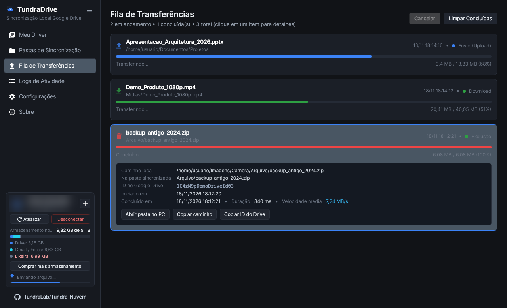
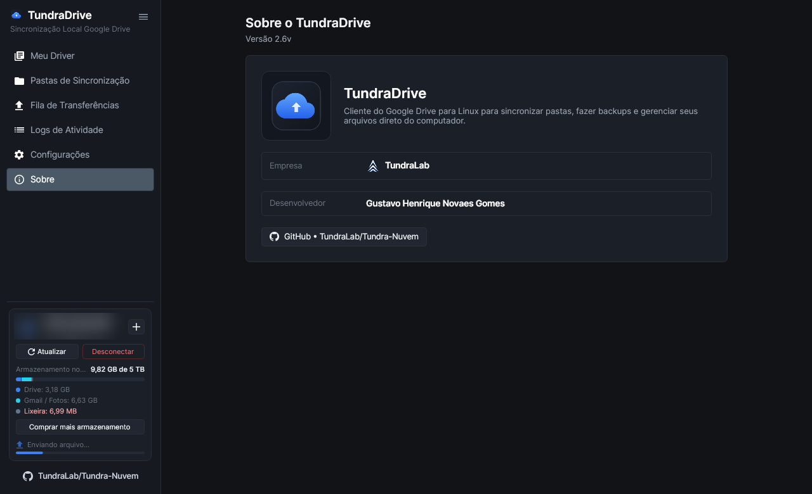
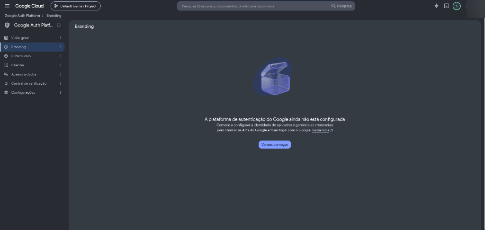
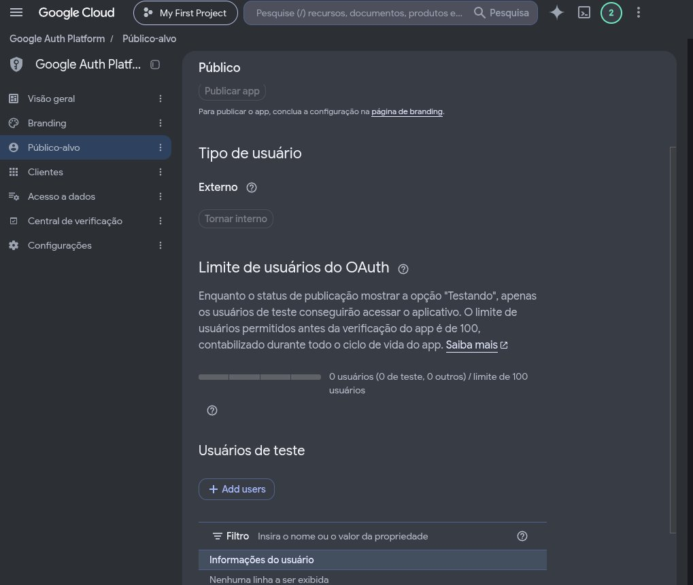
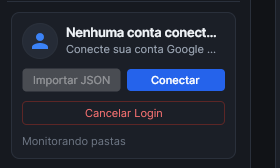
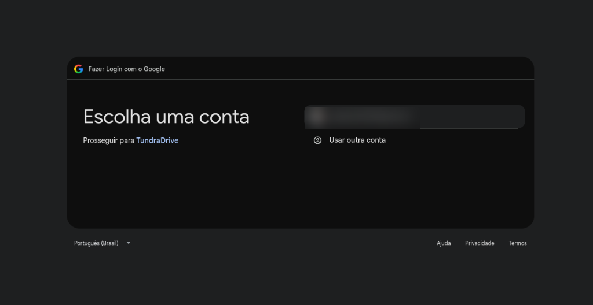
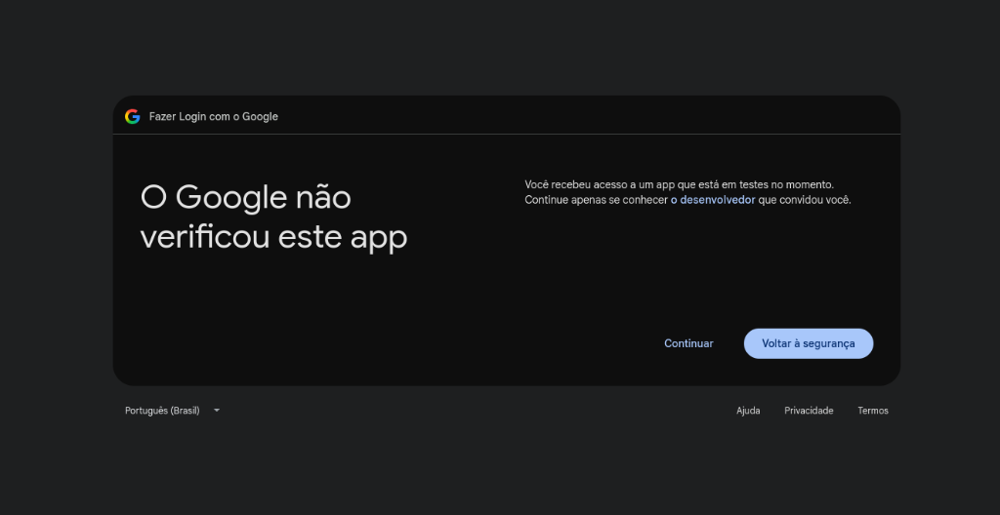

# TundraDrive v2.7.0

[](https://github.com/TundraLab/TundraDrive)
[](https://github.com/GustaHerin)
[](#sistemas-e-formatos)
[](#sistemas-e-formatos)
[](#sistemas-e-formatos)
[](#instalação)
[](https://dotnet.microsoft.com/)
[](https://avaloniaui.net/)
[](LICENSE)

Cliente do Google Drive para Linux para sincronizar pastas, fazer backups e gerenciar seus arquivos direto do computador. Feito em C# (.NET 10.0), Avalonia UI 11.3.8 e ASP.NET Core Minimal API em loopback (`127.0.0.1:5080`).

Repositório: https://github.com/TundraLab/TundraDrive

## Prévia visual


<details>
<summary>Ver todas as 6 telas individuais</summary>

| Tela | Prévia |
| :--- | :--- |
| **Meu Driver** |  |
| **Pastas de Sincronização** |  |
| **Fila de Transferências** |  |
| **Logs de Atividade** |  |
| **Configurações** |  |
| **Sobre** |  |

</details>

## Sistemas e formatos

- Testado em **Fedora** e **Pop!_OS** (incluindo hardware mais modesto), com suporte aos ambientes GNOME, COSMIC e KDE Plasma 5/6.
- **Formatos distribuídos:** pacote nativo **`.rpm`** (Fedora / RHEL / openSUSE) e **`.AppImage` (`x86_64`)** independente com o runtime `.NET 10` embutido (Pop!_OS, Ubuntu, Debian e demais distribuições Linux, sem precisar instalar dependências do `.NET`), ambos instalados e atualizados pelo instalador oficial no terminal.

## O que o aplicativo faz

- Navegação em **Meu Driver** pelas pastas do Google Drive, pelas pastas sincronizadas localmente e pela **Lixeira**, em modo Lista ou Grade com miniaturas.
- Seleção múltipla de arquivos (por caixas de seleção, `Ctrl + Clique`, `Shift + Clique` e `Ctrl + A`) para baixar, mover para Lixeira, restaurar ou excluir em lote, além de upload por arrastar e soltar ou seleção de vários arquivos.
- Pré-visualização de imagens, vídeos (miniatura, duração e player), áudios (forma de onda e reprodução interna), PDFs com troca de página, documentos Office (`DOCX`, `XLSX`, `PPTX`, `ODT`, `ODS`, `ODP`), Documentos Google e arquivos de código ou texto.
- Fila de transferências e barra lateral com animações distintas para upload (azul), download (verde) e exclusão (vermelho), além de detalhes expansíveis ao clicar em cada item (caminho completo, ID no Drive, duração, velocidade média e ações).
- Sincronização bidirecional (`PC <-> Drive`) ou backup unidirecional (`PC -> Drive`) por pasta, com verificação MD5/SHA256, resolução de conflitos, padrões ignorados e monitoramento em tempo real via `FileSystemWatcher`.
- Exclusões em pastas sincronizadas movem o item para a Lixeira do Google Drive (ou para a Lixeira do sistema no formato FreeDesktop compatível com GNOME Files e KDE Dolphin); exclusões definitivas só acontecem manualmente na aba Lixeira.
- Suporte a várias contas Google na barra lateral com alternância rápida, gráfico de cota por categoria (Drive, Gmail/Fotos e Lixeira) e revogação individual do `credentials.json` ou de cada conta.
- Limpador periódico de RAM (configurável em minutos ou acionado manualmente em Configurações).
- Tradução em Português (Brasil) e English (US), zoom da interface de 100% a 300% (`Ctrl++`, `Ctrl+-`, `Ctrl+0`), notificações nativas via D-Bus (`org.freedesktop.Notifications`, filtradas para evitar avisos sem alterações) e ícone na bandeja do sistema.
- Credenciais OAuth2 e tokens salvos localmente em `~/.config/tundradrive/` e `~/.local/share/tundradrive/tokens` com permissão `0600`.

## Modos de sincronização

Cada pasta mapeada pode operar em **Espelho Bidirecional (`PC <-> Drive`)** ou **Backup Unidirecional (`PC -> Drive`)**:

- **Espelho Bidirecional (`PC <-> Drive`):** mantém PC e Google Drive iguais nos dois sentidos. Alterações ou exclusões feitas em um lado são refletidas no outro.
- **Backup Unidirecional (`PC -> Drive`):** envia novidades e edições do PC para a nuvem sem baixar nem apagar arquivos no computador. Se um arquivo for apagado no Google Drive, a cópia local continua no PC e não volta para a nuvem sozinha (só reenvia se o arquivo voltar a ser editado localmente).

| Ação feita | Bidirecional (`PC <-> Drive`) | Backup Unidirecional (`PC -> Drive`) |
|---|---|---|
| Apagou no **PC** | Vai para Lixeira do Drive | Vai para Lixeira do Drive |
| Apagou no **Drive** | Vai para Lixeira do PC | Fica salvo no PC e não volta ao Drive |
| Adicionou no **Drive** | Baixa para o PC | Não baixa para o PC |
| Adicionou/editou no **PC** | Envia para o Drive | Envia para o Drive |

## Instalação

### 1. Instalador Interativo no Terminal (`TundraDrive by TundraLab` - Recomendado)

Abre instantaneamente no terminal, detecta sua distribuição Linux, baixa apenas o formato selecionado (**`.rpm`** ou **`.AppImage`**), valida a assinatura **SHA-256**, instala ícones/atalhos e configura inicialização automática:

```bash
curl -fsSL https://github.com/TundraLab/TundraDrive/releases/latest/download/TundraDrive-Installer-x86_64.sh -o install-tundradrive.sh
chmod +x install-tundradrive.sh
./install-tundradrive.sh
```

### 2. Baixar pacote direto pelo terminal (opcional)

- **AppImage (`x86_64`, roda direto sem instalar):**
  ```bash
  curl -fLO https://github.com/TundraLab/TundraDrive/releases/latest/download/TundraDrive-2.7.0-x86_64.AppImage
  chmod +x TundraDrive-2.7.0-x86_64.AppImage
  ./TundraDrive-2.7.0-x86_64.AppImage
  ```
- **Fedora / RHEL / openSUSE (`.rpm`):**
  ```bash
  curl -fLO https://github.com/TundraLab/TundraDrive/releases/latest/download/TundraDrive-2.7.0-1.x86_64.rpm
  sudo dnf install -y ./TundraDrive-2.7.0-1.x86_64.rpm
  ```

<details>
<summary>Opções avançadas (flags do instalador, extras de mídia e ícone no GNOME)</summary>

- **Atalhos do `install-tundradrive.sh`:**
  - `./install-tundradrive.sh --update`: detecta sua instalação atual (`.rpm` ou `.AppImage`) e atualiza para a versão mais recente do GitHub Releases.
  - `./install-tundradrive.sh --rpm`: baixa, valida `SHA-256` e instala o `.rpm`.
  - `./install-tundradrive.sh --appimage`: baixa, valida `SHA-256` e instala o `.AppImage` integrado ao usuário.
  - `./install-tundradrive.sh --download-only`: baixa `.rpm`, `.AppImage` e `SHA256SUMS.txt` na pasta atual.
  - `./install-tundradrive.sh --uninstall`: remove a instalação local ou `.rpm` mantendo suas configurações.
- **AppImage sem FUSE:** `./TundraDrive-2.7.0-x86_64.AppImage --appimage-extract-and-run`
- **Pacotes opcionais para pré-visualização completa (PDF, Office, áudio e vídeo):**
  - Fedora: `sudo dnf install poppler-utils ghostscript ffmpeg libreoffice ImageMagick`
  - Pop!_OS / Ubuntu: `sudo apt install poppler-utils ghostscript ffmpeg libreoffice imagemagick`
- **Ícone da nuvem na barra superior do GNOME Workstation** *(no KDE Plasma e Pop!_OS já funciona nativamente)*:
  ```bash
  sudo dnf install gnome-shell-extension-appindicator
  gsettings set org.gnome.shell enabled-extensions "['appindicatorsupport@rgcjonas.gmail.com']"
  ```
  *(Faça logout e login no GNOME após habilitar pela primeira vez.)*

</details>

## Como configurar o Google Drive (`credentials.json`)

Para conectar sua conta sem passar por servidores externos, crie suas credenciais OAuth2 Desktop no Google Cloud Console.

### Passo 1: Ativar a Google Drive API
1. Abra o [Google Cloud Console (Google Drive API)](https://console.cloud.google.com/apis/library/drive.googleapis.com).
2. Crie ou selecione um projeto no topo da página.
3. Clique em **Ativar** (*Enable*). Depois de ativa, a tela mostra **API ativada** e o botão **Gerenciar**:


### Passo 2: Abrir o menu de Credenciais OAuth
1. No menu lateral esquerdo, acesse **APIs e serviços > Credenciais** (ou abra [Credenciais](https://console.cloud.google.com/apis/credentials)).
2. Clique em **+ Criar credenciais** no topo e escolha **ID do cliente OAuth**:


Se escolher **Ajude-me a escolher**, marque **Google Drive API** e **Dados do usuário** (*User data*):


3. Se aparecer o aviso *"Para criar um ID do cliente OAuth, primeiro é preciso configurar sua tela de permissão"*, clique em **Configurar tela de consentimento**:


4. Na tela seguinte (**Branding**), clique em **Vamos começar** para abrir a configuração:



### Passo 3: Configurar a Tela de permissão OAuth (primeira vez do projeto)
Se for a primeira credencial do projeto, o Google pede a configuração da tela de consentimento (**Google Auth Platform**):
1. Em **Informações do app**, coloque o nome (por exemplo, `TundraDrive`) e seu e-mail de suporte. Clique em **Avançar**.
2. Em **Público**, escolha **Externo** (*External*) e clique em **Avançar**.
3. Em **Dados de contato**, informe seu e-mail novamente e clique em **Avançar**.
4. Aceite os termos e clique em **Criar**.


### Passo 4: Adicionar seu e-mail em Usuários de teste (obrigatório)
Enquanto o aplicativo estiver em modo **Testando** (*Testing*), o Google bloqueia logins (`Erro 403: access_denied`) de qualquer conta que não esteja na lista de testadores, incluindo a sua.
1. No menu esquerdo do **Google Auth Platform**, clique em **Público-alvo** ([abrir página](https://console.cloud.google.com/auth/audience)).
2. Desça até **Usuários de teste** e clique em **+ Add users**:



3. Informe o endereço Gmail que você vai usar no TundraDrive e clique em **Salvar**:


### Passo 5: Selecionar "App para computador" e baixar o JSON
1. No menu esquerdo, clique em **Clientes** e depois em **+ Criar cliente**:


2. Em **Tipo de aplicativo**, selecione **App para computador** (*Desktop app*):


3. Coloque `TundraDrive` no campo **Nome** e clique em **Criar**.
4. Na janela **Cliente OAuth criado**, clique em **Baixar o JSON** (o arquivo baixado terá um nome como `client_secret_...json`):


### Passo 6: Importar no TundraDrive e conectar
1. Abra o TundraDrive e olhe o cartão de conta no rodapé da barra lateral esquerda.
2. Clique em **Importar JSON** para selecionar o arquivo baixado (ele é validado e copiado internamente com permissão `0600`) e depois clique em **Conectar**:



3. No navegador que abrir:
   - Escolha a conta Google cadastrada no **Passo 4**:



   - Na tela *"O Google não verificou este app"*, clique em **Continuar**:



   - Na tela de permissões (*"O app TundraDrive quer acessar sua Conta do Google"*), clique em **Continuar**:


4. Depois de autorizar, use **Meu Driver** para navegar pelos arquivos e **Pastas de Sincronização** para vincular pastas do PC ao Drive.

Em **Configurações**, você pode trocar o idioma (PT-BR / EN-US), ajustar o zoom (100% a 300%), ligar inicialização com o sistema (`~/.config/autostart/tundradrive.desktop`), ativar bandeja/notificações, configurar o limpador de RAM, gerenciar o arquivo `credentials.json` e contas, ajustar intervalo de sincronização, conflitos, padrões ignorados e porta da API local.

## API REST Local (`127.0.0.1:5080`) e Agentes de IA

Guia completo com exemplos, schemas de Function Calling e cliente Python: **[TundraDrive-API.pdf](TundraDrive-API.pdf)** e **[docs/API.md](docs/API.md)**

- `GET /api/v1/status`: conta ativa, uso de cota, transferências e pastas sincronizadas.
- `GET /api/v1/openapi.json`: especificação OpenAPI 3.0.3 para autodescoberta por agentes de IA.
- `POST /api/v1/sync/trigger`: dispara sincronização total ou por `folderId` (`{"folderId": "...", "waitForCompletion": false}`).
- `GET /api/v1/files/search?q=relatorio&includeRemote=true`: busca no SQLite local e opcionalmente no Drive remoto.
- `GET /api/v1/files/list?folderId=root`: lista pastas e arquivos no Drive.
- `GET /api/v1/files/trash?limit=50`: lista itens na Lixeira do Drive.
- `POST /api/v1/folders`: cria uma pasta no Drive (`{"name": "MinhaPasta", "parentFolderId": "root"}`).
- `POST /api/v1/files/upload`: envia um arquivo local para o Drive (`{"localPath": "/caminho/arquivo.pdf", "remoteFolderId": "root"}`).
- `POST /api/v1/files/download`: baixa um arquivo do Drive (`{"remoteFileId": "...", "destinationPath": "/caminho/destino.pdf"}`).
- `POST /api/v1/files/{remoteFileId}/move`: move de pasta e/ou renomeia (`{"targetFolderId": "...", "newName": "novo-nome.txt"}`).
- `POST /api/v1/files/{remoteFileId}/trash`: envia um item para a Lixeira do Drive.
- `POST /api/v1/files/{remoteFileId}/restore`: restaura um item da Lixeira.
- `DELETE /api/v1/files/{remoteFileId}?permanent=true`: apaga definitivamente (ou envia para a Lixeira se omitir `permanent=true`).
- `GET /api/v1/transfers`: lista transferências ativas e recentes.
- `GET /api/v1/logs?limit=50`: consulta os logs de sincronização e ações.

<details>
<summary>Para desenvolvedores: compilar pelo código-fonte e estrutura do projeto</summary>

### Requisitos e execução

Instale o SDK `.NET 10.0` (`sudo dnf install dotnet-sdk-10.0` no Fedora ou `sudo apt install dotnet-sdk-10.0` no Pop!_OS/Ubuntu) e execute:

```bash
dotnet restore TundraDrive.sln
dotnet build TundraDrive.sln
dotnet test TundraDrive.sln
dotnet run --project src/TundraDrive.Desktop/TundraDrive.Desktop.csproj
```

Para gerar os pacotes `.AppImage` e `.rpm` (`x86_64`) localmente em `dist/`:

```bash
./packaging/linux/build-appimage.sh
./packaging/linux/build-rpm.sh
```

### Estrutura do código

- `src/TundraDrive.Core`: modelos, SQLite com Dapper (`~/.local/share/tundradrive/tundradrive.db`), cliente Google Drive v3 (`Google.Apis.Drive.v3`), fluxo OAuth2 com permissões `0600`, watcher local (`FileSystemWatcher`) e hash MD5/SHA256.
- `src/TundraDrive.Api`: servidor ASP.NET Core Minimal API em `127.0.0.1:5080` para scripts locais e agentes de IA.
- `src/TundraDrive.Desktop`: interface Avalonia UI 11.3.8 (MVVM com `CommunityToolkit.Mvvm`), bandeja do sistema e notificações.
- `tests/TundraDrive.Tests`: suíte de testes unitários xUnit.

</details>

## Licença e Propriedade Intelectual

**Todos os Direitos Reservados (`All Rights Reserved`)**
Copyright © 2026 **TundraLab** e **Gustavo Henrique Novaes Gomes** ([`@GustaHerin`](https://github.com/GustaHerin)).

- **Código-fonte (Portfólio e Auditoria):** Este repositório é público apenas para leitura, avaliação técnica e portfólio. Não é concedida permissão para copiar, modificar, redistribuir ou utilizar o código-fonte (no todo ou em parte) para fins comerciais ou projetos externos sem autorização prévia por escrito.
- **Uso dos pacotes oficiais (`.AppImage` / `.rpm`):** Usuários finais podem baixar, instalar e executar gratuitamente os instaladores oficiais publicados na aba **Releases** para uso pessoal ou corporativo interno, sendo vedada a redistribuição ou modificação comercial.

Consulte os termos completos em [LICENSE](LICENSE).
