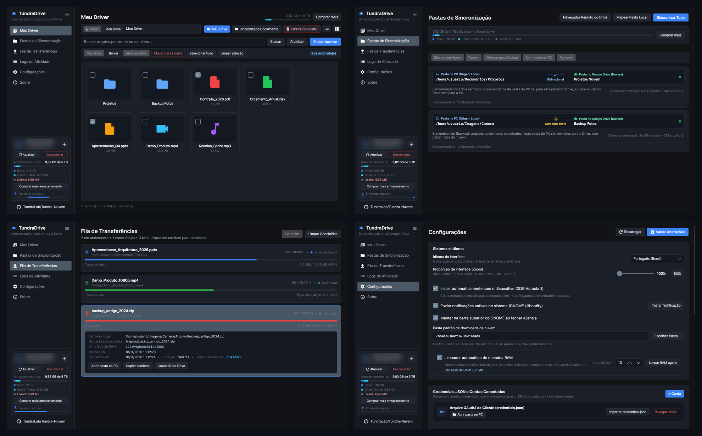

# Custódia v3.0.5

> 🌐 **Idioma / Language:** **🇧🇷 Português (atual)** | [🇺🇸 English](README.en.md)


[](https://github.com/TundraLab/Custodia)
[](https://github.com/GustaHerin)
[](https://github.com/TundraLab/Custodia/releases)
[](tests/Custodia.Tests)
[](#sistemas-e-formatos)
[](#sistemas-e-formatos)
[](#sistemas-e-formatos)
[](#instalação)
[](https://dotnet.microsoft.com/)
[](https://avaloniaui.net/)
[](LICENSE)
[](PRIVACY.md)
[](TERMS.md)

> **Em desenvolvimento desde:** 2026  
> **Status:** estável, com releases oficiais ([GitHub Releases](https://github.com/TundraLab/Custodia/releases))  
> **Plataforma:** Linux `x86_64`  
> **Objetivo:** sincronização segura e intuitiva com o Google Drive

**Meus arquivos. Sempre seguros.** Cliente desktop nativo para Linux focado em sincronização de pastas, backups locais, gerenciamento multimídia e automação local com privacidade direto no Google Drive.

## Qualidade

- **Build e distribuição:** compilação limpa em `.NET 10.0` para Linux `x86_64` com empacotamento nativo `.rpm` e `.AppImage` verificado por SHA-256
- **Suíte de testes:** **66 testes unitários xUnit aprovados (`0` falhas)** cobrindo motor de sincronização, fila de transferências, persistência SQLite, isolamento de contas OAuth2, atualizador, sanitização de suporte, aceite de termos/privacidade e e-mails de ciclo de vida
- **Plataforma principal:** Linux `x86_64` (Fedora Workstation/KDE, Pop!_OS GNOME/COSMIC e KDE Plasma 5/6)
- **Documentação técnica:** OpenAPI `3.0.3` em tempo real (`GET /api/v1/openapi.json`), guia [docs/API.md](docs/API.md), [Custodia-API.pdf](Custodia-API.pdf) e histórico completo em [CHANGELOG.md](CHANGELOG.md)

## Documentação

> Disponível em **[🇧🇷 Português](README.md)** e **[🇺🇸 English](README.en.md)**.

| Guia | Conteúdo |
| :--- | :--- |
| **[Configuração OAuth2](docs/OAUTH_SETUP.md)** | Passo a passo ilustrado para criar o `credentials.json` no Google Cloud Console e conectar sua conta |
| **[Compatibilidade Linux](docs/COMPATIBILITY.md)** | Matriz de recursos testados vs. suportados em GNOME, KDE Plasma 5/6, COSMIC, Wayland e X11 |
| **[Segurança e Privacidade](docs/SECURITY.md)** | Modelo BYO-OAuth2, permissões `0700`/`0600`, renovação de tokens e superfície da API local |
| **[Perguntas Frequentes (FAQ)](docs/FAQ.md)** | Modo offline, política de conflitos, restauração da Lixeira, múltiplas contas e remoção total |
| **[Solução de Problemas](docs/TROUBLESHOOTING.md)** | Diagnóstico para `.rpm`, `.AppImage`/FUSE, bandeja no GNOME, D-Bus, erro `403` e pré-visualização |
| **[API REST Local](docs/API.md)** | Endpoints em `127.0.0.1:5080`, OpenAPI `3.0.3`, exemplos em Python e integração com agentes de IA |

## Prévia visual



- **[Assistir vídeo de divulgação](docs/videos/custodia-divulgacao.mp4)** (`MP4`, 21 MB)

<details>
<summary>Ver todas as 6 telas individuais</summary>

| Tela | Prévia |
| :--- | :--- |
| **Meus Arquivos** |  |
| **Pastas de Sincronização** |  |
| **Fila de Transferências** |  |
| **Logs de Atividade** |  |
| **Configurações** |  |
| **Sobre** |  |

</details>

## Sistemas e formatos

- Testado em **Fedora** e **Pop!_OS** (incluindo hardware modesto), com suporte aos ambientes **GNOME**, **COSMIC** e **KDE Plasma 5/6** — veja a matriz completa em **[docs/COMPATIBILITY.md](docs/COMPATIBILITY.md)**.
- **Formatos distribuídos:** pacote nativo **`.rpm`** (Fedora / RHEL / openSUSE) e **`.AppImage` (`x86_64`)** independente com o runtime `.NET 10` embutido (Pop!_OS, Ubuntu, Debian e demais distribuições Linux, sem instalar dependências do `.NET`), ambos verificados por **SHA-256** (`SHA256SUMS.txt`).

## O que o aplicativo faz

- **Meus Arquivos com menu completo de botão direito:** navegação por **Meu Drive**, **Pastas Locais** e **Lixeira** em modo Lista ou Grade com miniaturas, seleção múltipla (`Ctrl + Clique`, `Shift + Clique`, `Ctrl + A`), upload por arrastar e soltar ou seleção múltipla e menu de contexto tanto sobre arquivos/pastas quanto em áreas vazias (**Nova Pasta**, **Enviar Arquivo**, **Personalizar pasta**, **Atualizar**, **Voltar**, **Selecionar Tudo** e **Mover para Lixeira** destacado em vermelho).
- **Personalização de pastas (cor, símbolo e apelido):** personalize diretamente com o botão direito em **Meus Arquivos** ou na aba **Pastas de Sincronização**, com cores e ícones preservados entre sessões.
- **Pré-visualização multimídia integrada:** imagens, vídeos (miniatura, duração e player), áudios (forma de onda e player interno), PDFs com navegação por páginas, documentos Office (`DOCX`, `XLSX`, `PPTX`, `ODT`, `ODS`, `ODP`), arquivos Google Workspace e texto/código.
- **Fila e ícone dinâmico na bandeja sem travamento:** fila sem teto de 200 itens, histórico expandido, banners animados em falhas de upload/download e ícone pulsante na barra superior que cresce e troca de cor/símbolo conforme o estado (`↑` upload azul, `↓` download verde, `✕` exclusão vermelho, `↻` sincronização e `!` erro), sincronizado com o menu nativo sem congelar status antigos.
- **Sincronização flexível por pasta:** modo **Bidirecional (`PC <-> Drive`)** ou **Backup Unidirecional (`PC -> Drive`)**, mapeamento múltiplo preservando nomes e subpastas vazias, validação por hash MD5/SHA256, política de conflitos, padrões ignorados e monitoramento contínuo de alterações locais em tempo real.
- **Lixeira segura:** exclusões em pastas sincronizadas enviam os itens para a Lixeira do Google Drive (ou para a Lixeira FreeDesktop do sistema compatível com GNOME Files e KDE Dolphin); exclusões permanentes ocorrem apenas manualmente na Lixeira.
- **Gestão avançada de múltiplas contas:** pastas dedicadas e legíveis por e-mail em `~/.config/custodia/contas/<email>/` (`credentials.json`, `conta.json` e `pastas-sincronizadas.json`), detecção automática de `client_secret_*.json` em `~/Downloads`, importação por arrastar e soltar em Configurações, inspeção de `Project ID` / `Client ID`, alternância rápida, reconexão e preservação automática de pastas ao remover/readicionar uma conta (com opção explícita para excluir a configuração).
- **Avisos de boas-vindas e revogação TundraLab:** envio opcional automático a partir de **`contato.tundralab@gmail.com`** via serviço dedicado TundraLab, sem precisar ativar a Gmail API nos projetos OAuth dos usuários.
- **Suporte e atualizações na aba Sobre:** verificação agendada de releases com proteção offline, formulário unificado com seletor **Bug / Erro** (`&labels=bug`) vs **Sugestão** (`&labels=enhancement`), diagnóstico técnico opcional e sanitizado apenas em relatórios de bug (prévia via **Ver dados** e limite seguro de URL preservando o log completo em **Copiar texto**).
- **Idioma, zoom, RAM e som:** PT-BR e EN-US, zoom de 100% a 300% (`Ctrl++`, `Ctrl+-`, `Ctrl+0`), limpador periódico de RAM e 6 variações de toques sintetizados nas notificações D-Bus (ou modo silencioso).

## Arquitetura

```text
  Interface Desktop (Avalonia UI — MVVM, Bandeja e Notificações)
                          │
                          ▼
   Núcleo de Sincronização (Sync Engine, OAuth2, Hashes e Updater)
     ├──▶ Google Drive API v3 (escopo drive direto da máquina do usuário)
     ├──▶ SQLite local (~/.local/share/custodia/custodia.db)
     ├──▶ Serviço de E-mail TundraLab (contato.tundralab@gmail.com)
     └──▶ API REST Local (ASP.NET Core + OpenAPI 3.0.3 em 127.0.0.1:5080)
```

- **Camada Desktop:** interface em Avalonia UI 11.3.8 com padrão MVVM, instância única garantida, ícone dinâmico na bandeja via D-Bus/AppIndicator e pré-visualização multimídia.
- **Núcleo de Sincronização:** motor bidirecional e unidirecional, resolução de conflitos, validação de integridade MD5/SHA256, monitoramento local contínuo, cofre OAuth2 por conta e verificador de atualizações oficiais.
- **API REST Local:** servidor HTTP Minimal API embarcado em *loopback* local (`127.0.0.1`) expondo endpoints REST e schema OpenAPI `3.0.3` para integração segura com scripts locais e agentes de IA.
- **Fluxo de dados:** mudanças locais ou remotas são comparadas com o estado persistido no SQLite e sincronizadas diretamente com a Google Drive API v3, atualizando em tempo real a fila de transferências e os registros locais.

## Decisões técnicas

- **C# e `.NET 10.0`:** escolhido pela tipagem forte, excelente suporte a concorrência assíncrona controlada e publicação *self-contained* estável para Linux `x86_64`.
- **Avalonia UI (`11.3.8`):** escolhida para entregar uma UI fluida e consistente entre GNOME, COSMIC e KDE Plasma (X11 e Wayland) com baixo consumo de memória e arquitetura MVVM testável.
- **SQLite + Dapper:** escolhidos por oferecerem banco relacional local leve, transacional (ACID) e de baixa latência sem exigir serviço externo instalado no PC do usuário.
- **Google Drive API v3 direta:** escolhida para que arquivos e tokens trafeguem somente entre o computador do usuário e o Google Drive, sem servidores intermediários.
- **AppImage e RPM (`x86_64`):** `.rpm` oferece integração nativa no Fedora e derivados, enquanto o `.AppImage` garante execução universal em Ubuntu/Pop!_OS e outras distros sem exigir SDK ou runtime externo.
- **API Local em `127.0.0.1:5080`:** restringe automações e agentes de IA à própria máquina, permitindo operar arquivos sem expor tokens OAuth nem abrir portas na rede externa.

## Modos de sincronização

Cada pasta mapeada pode operar em **Espelho Bidirecional (`PC <-> Drive`)** ou **Backup Unidirecional (`PC -> Drive`)**:

| Ação feita | Bidirecional (`PC <-> Drive`) | Backup Unidirecional (`PC -> Drive`) |
| :--- | :--- | :--- |
| Apagou no **PC** | Vai para Lixeira do Drive | Vai para Lixeira do Drive |
| Apagou no **Drive** | Vai para Lixeira do PC | Fica salvo no PC e não volta ao Drive |
| Adicionou no **Drive** | Baixa para o PC | Não baixa para o PC |
| Adicionou/editou no **PC** | Envia para o Drive | Envia para o Drive |

## Instalação

### 1. Instalador Interativo no Terminal (`Custódia by TundraLab` - Recomendado)

Detecta sua distribuição Linux, baixa apenas o formato escolhido (**`.rpm`** ou **`.AppImage`**), valida **SHA-256**, instala ícones/atalhos e configura inicialização automática:

```bash
curl -fsSL https://github.com/TundraLab/Custodia/releases/latest/download/Custodia-Installer-x86_64.sh -o install-custodia.sh
chmod +x install-custodia.sh
./install-custodia.sh
```

### 2. Baixar pacote direto pelo terminal (opcional)

- **AppImage (`x86_64`, roda direto sem instalar):**
  ```bash
  curl -fLO https://github.com/TundraLab/Custodia/releases/latest/download/Custodia-3.0.5-x86_64.AppImage
  chmod +x Custodia-3.0.5-x86_64.AppImage
  ./Custodia-3.0.5-x86_64.AppImage
  ```
- **Fedora / RHEL / openSUSE (`.rpm`):**
  ```bash
  curl -fLO https://github.com/TundraLab/Custodia/releases/latest/download/Custodia-3.0.5-1.x86_64.rpm
  sudo dnf install -y ./Custodia-3.0.5-1.x86_64.rpm
  ```

<details>
<summary>Opções avançadas (flags do instalador, extras de mídia e ícone no GNOME)</summary>

- **Atalhos do `install-custodia.sh`:**
  - `./install-custodia.sh --update`: detecta sua instalação atual (`.rpm` ou `.AppImage`) e atualiza para a release mais recente.
  - `./install-custodia.sh --rpm`: baixa, valida `SHA-256` e instala o `.rpm`.
  - `./install-custodia.sh --appimage`: baixa, valida `SHA-256` e instala o `.AppImage` integrado ao usuário.
  - `./install-custodia.sh --download-only`: baixa `.rpm`, `.AppImage` e `SHA256SUMS.txt` na pasta atual.
  - `./install-custodia.sh --uninstall`: remove a instalação local ou `.rpm` mantendo suas configurações.
- **AppImage sem FUSE:** `./Custodia-3.0.5-x86_64.AppImage --appimage-extract-and-run`
- **Pacotes opcionais para pré-visualização completa (PDF, Office, áudio e vídeo):**
  - Fedora: `sudo dnf install poppler-utils ghostscript ffmpeg libreoffice ImageMagick`
  - Pop!_OS / Ubuntu: `sudo apt install poppler-utils ghostscript ffmpeg libreoffice imagemagick`
- **Ícone da nuvem na barra superior do GNOME Workstation** *(no KDE Plasma e Pop!_OS já funciona nativamente)*:
  ```bash
  sudo dnf install gnome-shell-extension-appindicator
  gsettings set org.gnome.shell enabled-extensions "['appindicatorsupport@rgcjonas.gmail.com']"
  ```
  *(Faça logout e login no GNOME após habilitar pela primeira vez.)*

</details>

## Como configurar o Google Drive (`credentials.json`)

Para conectar sua conta diretamente ao Google sem servidores intermediários, crie suas credenciais OAuth2 Desktop no Google Cloud Console:

1. Ative a **Google Drive API** no seu projeto do Google Cloud Console.
2. Configure a **Tela de permissão OAuth** (*Google Auth Platform* → **Externo**).
3. Adicione seu e-mail em **Público-alvo → Usuários de teste** *(obrigatório enquanto o app estiver em modo Testando)*.
4. Em **Clientes → + Criar cliente**, escolha **App para computador** (*Desktop app*) e baixe o arquivo `client_secret_*.json`.
5. Importe o JSON no Custódia (detectado automaticamente em `~/Downloads` ou via arrastar e soltar em **Configurações**) e autorize no navegador.

> **Guia completo com capturas de tela de cada etapa:** **[docs/OAUTH_SETUP.md](docs/OAUTH_SETUP.md)**  
> Enfrentando erro `403: access_denied` ou problemas na bandeja/AppImage? Consulte **[docs/TROUBLESHOOTING.md](docs/TROUBLESHOOTING.md)** e **[docs/FAQ.md](docs/FAQ.md)**.

## Segurança e Privacidade

Consulte a arquitetura completa em **[docs/SECURITY.md](docs/SECURITY.md)**.

- **Isolamento local e permissões restritas (`0700` / `0600`):**
  - `~/.config/custodia/settings.json`: preferências gerais e personalizações visuais de pastas.
  - `~/.config/custodia/contas/<email>/`: diretório organizado por conta contendo `credentials.json`, `conta.json` e `pastas-sincronizadas.json` com acesso restrito ao usuário (`0600`).
  - `~/.local/share/custodia/tokens/`: tokens OAuth2 armazenados localmente com permissão `0600`.
  - `~/.local/share/custodia/custodia.db`: banco SQLite local com mapeamentos, metadados e logs de atividade.
- **Como os tokens são renovados:** o SDK oficial do Google utiliza o `refresh_token` salvo localmente (`0600`) para obter novos `access_token` temporários diretamente com o endpoint OAuth2 do Google, sem intervenção manual nem armazenamento de senha.
- **O JSON OAuth não contém sua senha:** o `client_secret_*.json` identifica apenas o ID de aplicativo criado por você no Google Cloud Console; sua senha é digitada apenas na página oficial de login do Google no navegador.
- **O que acontece ao revogar/desconectar uma conta:** o token local é invalidado/removido, o diretório `~/.config/custodia/contas/<email>/` tem a sessão encerrada e você escolhe explicitamente na janela de confirmação se deseja manter ou excluir também as pastas configuradas vinculadas àquele e-mail.
- **Superfície da API local:** o servidor REST embarcado escuta exclusivamente em `127.0.0.1:5080` (nunca em `0.0.0.0`) e **não deve ser exposto para fora do dispositivo** (ex.: via proxy reverso ou túnel público).
- **Como remover completamente todos os dados locais:**
  ```bash
  ./install-custodia.sh --uninstall
  rm -rf ~/.config/custodia ~/.local/share/custodia ~/.cache/custodia
  ```

## Privacidade, Conformidade Google OAuth e Termos de Uso

Documentos oficiais disponíveis no repositório: **[Política de Privacidade](PRIVACY.md)** | **[Termos de Uso](TERMS.md)** | **[Licença Proprietária](LICENSE)**.

- **Classificação do escopo e modelo BYO-OAuth:** o Custódia solicita o escopo `https://www.googleapis.com/auth/drive` (classificado como **escopo sensível** pela [documentação oficial do Google](https://developers.google.com/identity/protocols/oauth2/scopes)). Na configuração atual, cada usuário cria e utiliza suas próprias credenciais OAuth no Google Cloud Console estritamente para **uso pessoal/individual** — isso **não** dispensa o processo formal de [Verificação OAuth do Google](https://support.google.com/cloud/answer/9110914) caso um Client ID compartilhado venha a ser distribuído publicamente pela TundraLab.
- **Uso Limitado (Limited Use):** o uso de dados obtidos das APIs do Google segue a [Google API Services User Data Policy](https://developers.google.com/terms/api-services-user-data-policy). Seus arquivos do Drive, pastas, metadados, hashes e tokens OAuth permanecem exclusivamente na sua máquina e nunca são enviados a servidores da TundraLab.
- **E-mails opcionais de ciclo de vida (`contato.tundralab@gmail.com`):** nenhum escopo do Gmail é solicitado no seu projeto Google Cloud. Caso você mantenha os alertas de conta habilitados no Custódia, apenas `recipientEmail`, `recipientName`, `eventType` (`connect` ou `revoke`), `appName`, `appVersion`, `language` e `timestampUtc` são enviados ao serviço de disparo oficial da TundraLab exclusivamente para notificar conexão ou revogação da conta — recurso opcional que pode ser recusado logo na primeira execução ou alterado a qualquer momento em **Sobre -> Rever termo inicial**.
- **Aviso ao baixar/instalar e na primeira execução:** tanto o instalador de terminal (`install-custodia.sh`) quanto o aplicativo desktop exibem o resumo da Política de Privacidade e dos Termos de Uso com aceite explícito antes do primeiro uso.

## API REST Local (`127.0.0.1:5080`) e Agentes de IA

Guia completo com exemplos, schemas de Function Calling e cliente Python: **[Custodia-API.pdf](Custodia-API.pdf)** e **[docs/API.md](docs/API.md)**.

- `GET /api/v1/status`: conta ativa, uso de cota, transferências e pastas sincronizadas.
- `GET /api/v1/openapi.json`: especificação OpenAPI 3.0.3 para autodescoberta por agentes de IA.
- `POST /api/v1/sync/trigger`: dispara sincronização total ou por `folderId` (`{"folderId": "...", "waitForCompletion": false}`).
- `GET /api/v1/files/search?q=relatorio&includeRemote=true`: busca no SQLite local e opcionalmente no Drive remoto.
- `GET /api/v1/files/list?folderId=root`: lista pastas e arquivos no Drive.
- `GET /api/v1/files/trash?limit=50`: lista itens na Lixeira do Drive.
- `POST /api/v1/folders`: cria uma pasta no Drive (`{"name": "MinhaPasta", "parentFolderId": "root"}`).
- `POST /api/v1/files/upload`: envia um arquivo local para o Drive (`{"localPath": "/caminho/arquivo.pdf", "remoteFolderId": "root"}`).
- `POST /api/v1/files/download`: baixa um arquivo do Drive (`{"remoteFileId": "...", "destinationPath": "/caminho/destino.pdf"}`).
- `POST /api/v1/files/{remoteFileId}/move`: move de pasta e/ou renomeia (`{"targetFolderId": "...", "newName": "novo-nome.txt"}`).
- `POST /api/v1/files/{remoteFileId}/trash`: envia um item para a Lixeira do Drive.
- `POST /api/v1/files/{remoteFileId}/restore`: restaura um item da Lixeira.
- `DELETE /api/v1/files/{remoteFileId}?permanent=true`: apaga definitivamente (ou envia para a Lixeira se omitir `permanent=true`).
- `GET /api/v1/transfers`: lista transferências ativas e recentes.
- `GET /api/v1/logs?limit=50`: consulta os logs de sincronização e ações.

## Licença e Propriedade Intelectual

**Software Proprietário (Source-Available).**  
**Todos os Direitos Reservados (All Rights Reserved)**  
Copyright © 2026 TundraLab e Gustavo Henrique Novaes Gomes (@GustaHerin).

- **Acesso ao Código-Fonte (Portfólio, Estudo e Auditoria):** Embora este repositório seja público — permitindo tecnicamente que usuários visualizem, clonem localmente ou criem *fork* no GitHub estritamente para visualização, leitura, estudo e avaliação técnica —, **não é código aberto (*open source*)**. Nenhuma permissão ou licença é concedida para copiar, reproduzir, modificar, adaptar, criar obras derivadas, sublicenciar, distribuir, publicar ou utilizar trechos do código-fonte (no todo ou em parte) em outros projetos (comerciais ou não) sem autorização prévia e expressa por escrito dos titulares.
- **Uso dos Binários Oficiais (`.AppImage` / `.rpm`):** Usuários finais recebem licença gratuita, não exclusiva, intransferível e revogável para baixar, instalar e executar os pacotes oficiais publicados em [Releases](https://github.com/TundraLab/Custodia/releases), exclusivamente para uso pessoal ou corporativo interno, sendo vedada a redistribuição (gratuita ou comercial), revenda, oferta como serviço (SaaS), modificação ou engenharia reversa fora dos limites expressos em lei.
- **Contribuições Externas, Marcas e Terceiros:** Eventuais sugestões, relatórios de erro ou Pull Requests concedem aos autores licença irrevogável e livre de royalties para incorporação ao Software; esta licença não autoriza o uso dos nomes **"TundraLab"**, **"Custódia"** ou da identidade visual, e bibliotecas de terceiros seguem suas respectivas licenças originais.

Consulte o texto integral e vinculante em [LICENSE](./LICENSE).
