# Custódia v2.9.2

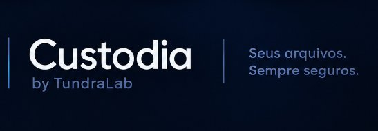

[](https://github.com/TundraLab/Custodia)
[](https://github.com/GustaHerin)
[](https://github.com/TundraLab/Custodia/releases)
[](tests/Custodia.Tests)
[](#sistemas-e-formatos)
[](#sistemas-e-formatos)
[](#sistemas-e-formatos)
[](#instalação)
[](https://dotnet.microsoft.com/)
[](https://avaloniaui.net/)
[](LICENSE)

> **Em desenvolvimento desde:** 2026  
> **Status:** estável, com releases oficiais ([GitHub Releases](https://github.com/TundraLab/Custodia/releases))  
> **Plataforma:** Linux `x86_64`  
> **Objetivo:** sincronização segura e intuitiva com o Google Drive

**Meus arquivos. Sempre seguros.** Cliente desktop nativo para Linux focado em sincronização de pastas, backups locais, gerenciamento multimídia e automação local com privacidade direto no Google Drive.

## Qualidade

- **Build local:** compilação limpa em `.NET 10.0` (`Custodia.sln` — `Custodia.Core`, `Custodia.Api`, `Custodia.Desktop` e pacotes `x86_64` `.rpm` / `.AppImage`)
- **Suíte de testes:** **53 testes unitários xUnit aprovados (`0` falhas)** via `dotnet test Custodia.sln` cobrindo sincronização, fila de transferências, persistência SQLite, isolamento de contas OAuth2, atualizador, sanitização de suporte e envio de ciclo de vida
- **Plataforma principal:** Linux `x86_64` (Fedora Workstation/KDE, Pop!_OS GNOME/COSMIC e KDE Plasma 5/6)
- **Documentação técnica:** OpenAPI `3.0.3` em tempo real (`GET /api/v1/openapi.json`), guia [docs/API.md](docs/API.md), [Custodia-API.pdf](Custodia-API.pdf) e histórico completo em [CHANGELOG.md](CHANGELOG.md)

## Prévia visual


<details>
<summary>Ver todas as 6 telas individuais</summary>

| Tela | Prévia |
| :--- | :--- |
| **Meus Arquivos** | 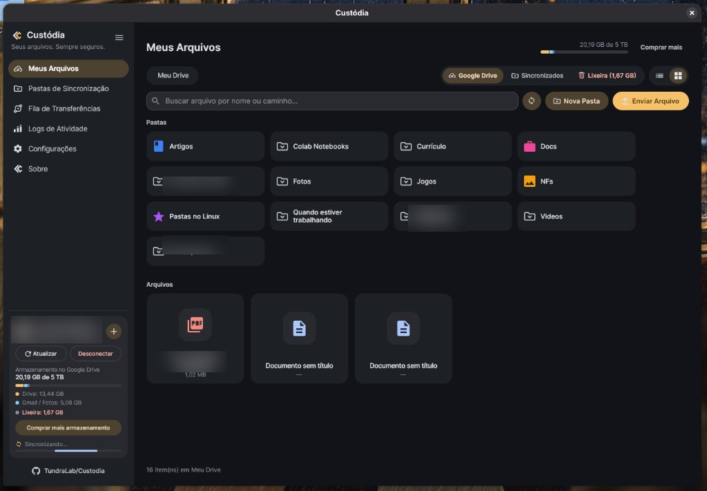 |
| **Pastas de Sincronização** | 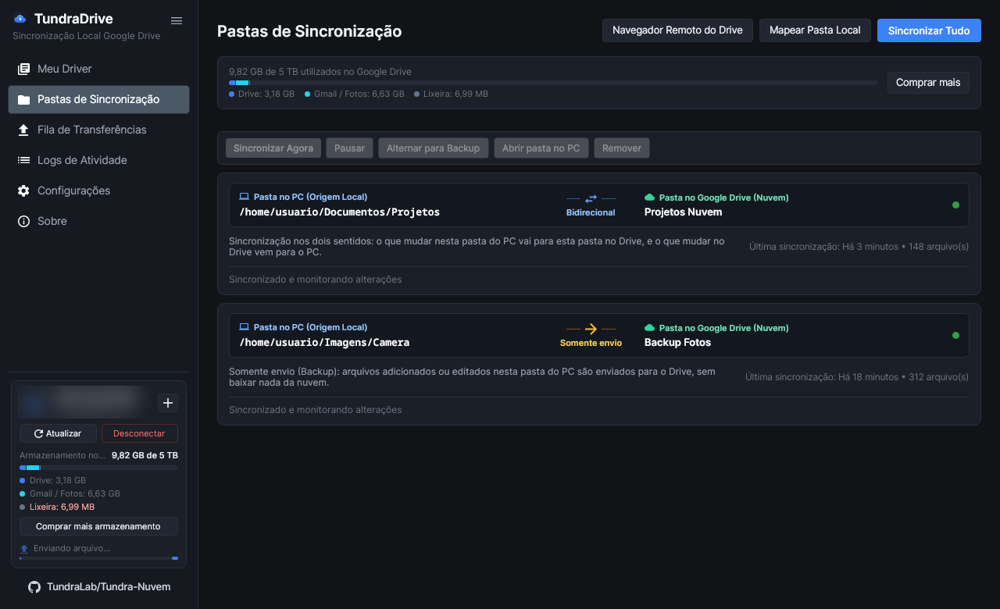 |
| **Fila de Transferências** |  |
| **Logs de Atividade** | 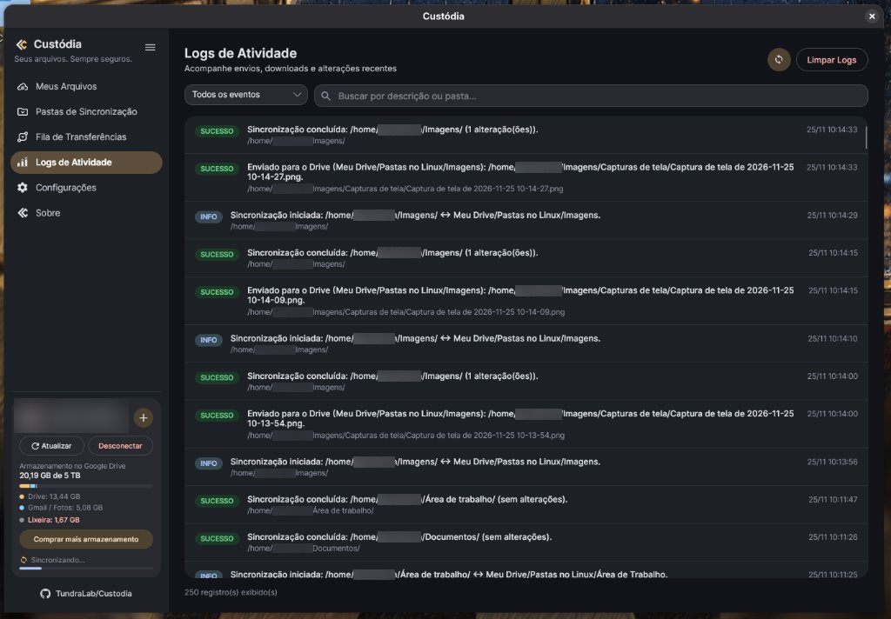 |
| **Configurações** | 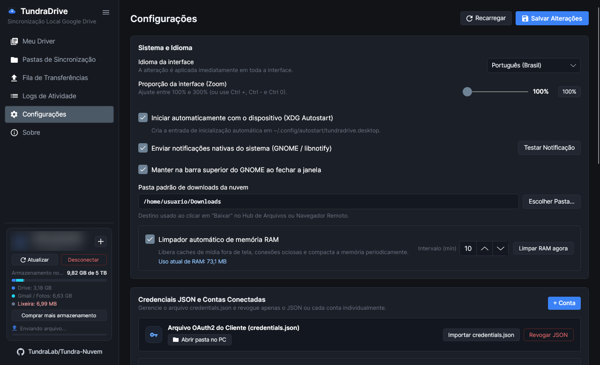 |
| **Sobre** |  |

</details>

## Sistemas e formatos

- Testado em **Fedora** e **Pop!_OS** (incluindo hardware modesto), com suporte aos ambientes GNOME, COSMIC e KDE Plasma 5/6.
- **Formatos distribuídos:** pacote nativo **`.rpm`** (Fedora / RHEL / openSUSE) e **`.AppImage` (`x86_64`)** independente com o runtime `.NET 10` embutido (Pop!_OS, Ubuntu, Debian e demais distribuições Linux, sem instalar dependências do `.NET`), ambos verificados por **SHA-256** (`SHA256SUMS.txt`).

## O que o aplicativo faz

- **Meus Arquivos com menu completo de botão direito:** navegação por **Meu Drive**, **Pastas Locais** e **Lixeira** em modo Lista ou Grade com miniaturas, seleção múltipla (`Ctrl + Clique`, `Shift + Clique`, `Ctrl + A`), upload por arrastar e soltar ou seleção múltipla e menu de contexto tanto sobre arquivos/pastas quanto em áreas vazias (**Nova Pasta**, **Enviar Arquivo**, **Personalizar pasta**, **Atualizar**, **Voltar**, **Selecionar Tudo** e **Mover para Lixeira** destacado em vermelho).
- **Personalização de pastas (cor, símbolo e apelido):** personalize diretamente com o botão direito em **Meus Arquivos** ou na aba **Pastas de Sincronização**, com cores e ícones preservados entre sessões.
- **Pré-visualização multimídia integrada:** imagens, vídeos (miniatura, duração e player), áudios (forma de onda e player interno), PDFs com navegação por páginas, documentos Office (`DOCX`, `XLSX`, `PPTX`, `ODT`, `ODS`, `ODP`), arquivos Google Workspace e texto/código.
- **Fila e ícone dinâmico na bandeja sem travamento:** fila sem teto de 200 itens, histórico expandido, banners animados em falhas de upload/download e ícone pulsante na barra superior que cresce e troca de cor/símbolo conforme o estado (`↑` upload azul, `↓` download verde, `✕` exclusão vermelho, `↻` sincronização e `!` erro), sincronizado com o menu nativo sem congelar status antigos.
- **Sincronização flexível por pasta:** modo **Bidirecional (`PC <-> Drive`)** ou **Backup Unidirecional (`PC -> Drive`)**, mapeamento múltiplo preservando nomes e subpastas vazias, validação por hash MD5/SHA256, política de conflitos, padrões ignorados e monitoramento em tempo real com `FileSystemWatcher`.
- **Lixeira segura:** exclusões em pastas sincronizadas enviam os itens para a Lixeira do Google Drive (ou para a Lixeira FreeDesktop do sistema compatível com GNOME Files e KDE Dolphin); exclusões permanentes ocorrem apenas manualmente na Lixeira.
- **Gestão avançada de múltiplas contas:** pastas dedicadas e legíveis por e-mail em `~/.config/custodia/contas/<email>/` (`credentials.json`, `conta.json` e `pastas-sincronizadas.json`), detecção automática de `client_secret_*.json` em `~/Downloads`, importação por arrastar e soltar em Configurações, inspeção de `Project ID` / `Client ID`, alternância rápida, reconexão e preservação automática de pastas ao remover/readicionar uma conta (com opção explícita para excluir a configuração).
- **Avisos de boas-vindas e revogação TundraLab:** envio opcional automático a partir de **`contato.tundralab@gmail.com`** via serviço Google Apps Script ([docs/apps-script/contato-tundralab-mailer.gs](docs/apps-script/contato-tundralab-mailer.gs)), sem precisar ativar a Gmail API nos projetos OAuth dos usuários.
- **Suporte e atualizações na aba Sobre:** verificação agendada de releases com proteção offline, formulário unificado com seletor **Bug / Erro** (`&labels=bug`) vs **Sugestão** (`&labels=enhancement`), diagnóstico técnico opcional e sanitizado apenas em relatórios de bug (prévia via **Ver dados** e limite seguro de URL preservando o log completo em **Copiar texto**).
- **Idioma, zoom, RAM e som:** PT-BR e EN-US, zoom de 100% a 300% (`Ctrl++`, `Ctrl+-`, `Ctrl+0`), limpador periódico de RAM e 6 variações de toques sintetizados nas notificações D-Bus (ou modo silencioso).

## Arquitetura

```text
  Avalonia UI (Custodia.Desktop — MVVM, Bandeja e Notificações)
                          │
                          ▼
   Custodia.Core (Sync Engine, OAuth2, Watcher, Hashes e Updater)
     ├──▶ Google Drive API v3 (escopo drive direto da máquina do usuário)
     ├──▶ SQLite + Dapper (~/.local/share/custodia/custodia.db)
     ├──▶ Mailer TundraLab (Apps Script -> contato.tundralab@gmail.com)
     └──▶ Custodia.Api (ASP.NET Core Minimal API + OpenAPI 3.0.3 em 127.0.0.1:5080)
```

- **`Custodia.Desktop`:** camada visual em Avalonia UI 11.3.8 (`CommunityToolkit.Mvvm`), gerenciamento de janela única (`SingleInstanceGuard`), ícone pulsante de bandeja via D-Bus/AppIndicator e pré-visualização multimídia.
- **`Custodia.Core`:** motor de sincronização bidirecional e unidirecional, resolução de conflitos, verificação MD5/SHA256, observador de arquivos (`FileSystemWatcher`), cofre de credenciais por conta e atualizador via GitHub Releases.
- **`Custodia.Api`:** servidor HTTP Minimal API embarcado em *loopback* local (`127.0.0.1`) expondo endpoints REST e schema OpenAPI `3.0.3` para integração segura com automações e agentes de IA.
- **Fluxo de dados:** alterações locais detectadas pelo watcher ou varredura periódica são comparadas com o estado persistido no SQLite e aplicadas na Google Drive API v3; todas as operações alimentam a fila visual em tempo real e o histórico local.

## Decisões técnicas

- **C# e `.NET 10.0`:** escolhido pela tipagem forte, excelente suporte a concorrência assíncrona (`SemaphoreSlim`, `PeriodicTimer`, `CancellationToken`) e capacidade de publicar binários *self-contained* rápidos para Linux `x86_64`.
- **Avalonia UI (`11.3.8`):** escolhido para entregar uma UI fluida e consistente entre GNOME, COSMIC e KDE Plasma (X11 e Wayland) com *compiled bindings*, baixo consumo de memória e arquitetura MVVM testável.
- **SQLite + Dapper:** escolhido por oferecer banco relacional local leve, transacional (ACID) e de latência mínima sem exigir serviço externo instalado no PC do usuário.
- **Google Drive API v3 direta:** escolhida para que arquivos e tokens trafeguem somente entre o computador do usuário e o Google Drive, eliminando dependência de servidores intermediários.
- **AppImage e RPM (`x86_64`):** `.rpm` oferece integração nativa via `dnf`/`rpm` no Fedora e derivados, enquanto o `.AppImage` garante execução universal em Ubuntu/Pop!_OS e outras distros sem exigir SDK ou runtime externo.
- **API Local em `127.0.0.1:5080`:** restringe automações locais e agentes de IA à máquina do usuário, garantindo que scripts usem o cliente já autenticado sem manipular tokens OAuth diretamente nem abrir portas na rede local.

## Modos de sincronização

Cada pasta mapeada pode operar em **Espelho Bidirecional (`PC <-> Drive`)** ou **Backup Unidirecional (`PC -> Drive`)**:

| Ação feita | Bidirecional (`PC <-> Drive`) | Backup Unidirecional (`PC -> Drive`) |
| :--- | :--- | :--- |
| Apagou no **PC** | Vai para Lixeira do Drive | Vai para Lixeira do Drive |
| Apagou no **Drive** | Vai para Lixeira do PC | Fica salvo no PC e não volta ao Drive |
| Adicionou no **Drive** | Baixa para o PC | Não baixa para o PC |
| Adicionou/editou no **PC** | Envia para o Drive | Envia para o Drive |

## Instalação

### 1. Instalador Interativo no Terminal (`Custódia by TundraLab` - Recomendado)

Detecta sua distribuição Linux, baixa apenas o formato escolhido (**`.rpm`** ou **`.AppImage`**), valida **SHA-256**, instala ícones/atalhos e configura inicialização automática:

```bash
curl -fsSL https://github.com/TundraLab/Custodia/releases/latest/download/Custodia-Installer-x86_64.sh -o install-custodia.sh
chmod +x install-custodia.sh
./install-custodia.sh
```

### 2. Baixar pacote direto pelo terminal (opcional)

- **AppImage (`x86_64`, roda direto sem instalar):**
  ```bash
  curl -fLO https://github.com/TundraLab/Custodia/releases/latest/download/Custodia-2.9.2-x86_64.AppImage
  chmod +x Custodia-2.9.2-x86_64.AppImage
  ./Custodia-2.9.2-x86_64.AppImage
  ```
- **Fedora / RHEL / openSUSE (`.rpm`):**
  ```bash
  curl -fLO https://github.com/TundraLab/Custodia/releases/latest/download/Custodia-2.9.2-1.x86_64.rpm
  sudo dnf install -y ./Custodia-2.9.2-1.x86_64.rpm
  ```

<details>
<summary>Opções avançadas (flags do instalador, extras de mídia e ícone no GNOME)</summary>

- **Atalhos do `install-custodia.sh`:**
  - `./install-custodia.sh --update`: detecta sua instalação atual (`.rpm` ou `.AppImage`) e atualiza para a release mais recente.
  - `./install-custodia.sh --rpm`: baixa, valida `SHA-256` e instala o `.rpm`.
  - `./install-custodia.sh --appimage`: baixa, valida `SHA-256` e instala o `.AppImage` integrado ao usuário.
  - `./install-custodia.sh --download-only`: baixa `.rpm`, `.AppImage` e `SHA256SUMS.txt` na pasta atual.
  - `./install-custodia.sh --uninstall`: remove a instalação local ou `.rpm` mantendo suas configurações.
- **AppImage sem FUSE:** `./Custodia-2.9.2-x86_64.AppImage --appimage-extract-and-run`
- **Pacotes opcionais para pré-visualização completa (PDF, Office, áudio e vídeo):**
  - Fedora: `sudo dnf install poppler-utils ghostscript ffmpeg libreoffice ImageMagick`
  - Pop!_OS / Ubuntu: `sudo apt install poppler-utils ghostscript ffmpeg libreoffice imagemagick`
- **Ícone da nuvem na barra superior do GNOME Workstation** *(no KDE Plasma e Pop!_OS já funciona nativamente)*:
  ```bash
  sudo dnf install gnome-shell-extension-appindicator
  gsettings set org.gnome.shell enabled-extensions "['appindicatorsupport@rgcjonas.gmail.com']"
  ```
  *(Faça logout e login no GNOME após habilitar pela primeira vez.)*

</details>

## Como configurar o Google Drive (`credentials.json`)

Para conectar sua conta diretamente ao Google sem servidores intermediários, crie suas credenciais OAuth2 Desktop no Google Cloud Console.

### Passo 1: Ativar a Google Drive API
1. Abra o [Google Cloud Console (Google Drive API)](https://console.cloud.google.com/apis/library/drive.googleapis.com).
2. Crie ou selecione um projeto no topo da página.
3. Clique em **Ativar** (*Enable*). Depois de ativa, a tela mostra **API ativada** e o botão **Gerenciar**. *(Não é necessário ativar a Gmail API no projeto.)*

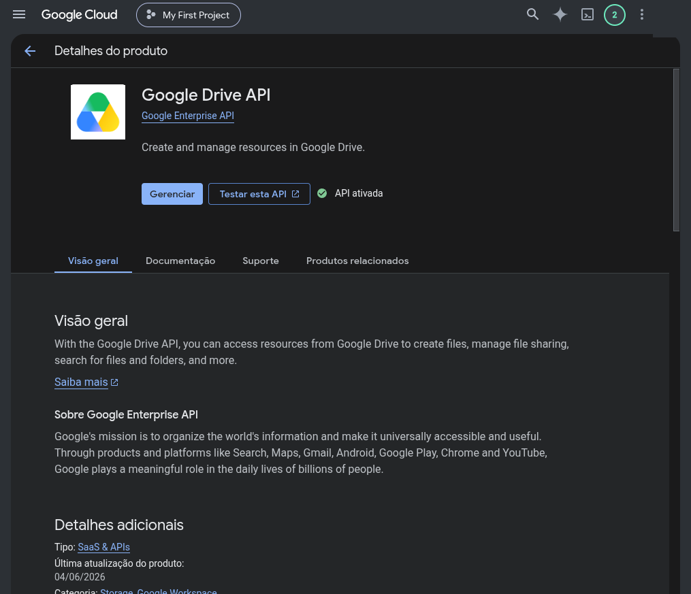

### Passo 2: Abrir o menu de Credenciais OAuth
1. No menu lateral esquerdo, acesse **APIs e serviços > Credenciais** (ou abra [Credenciais](https://console.cloud.google.com/apis/credentials)).
2. Clique em **+ Criar credenciais** no topo e escolha **ID do cliente OAuth**:

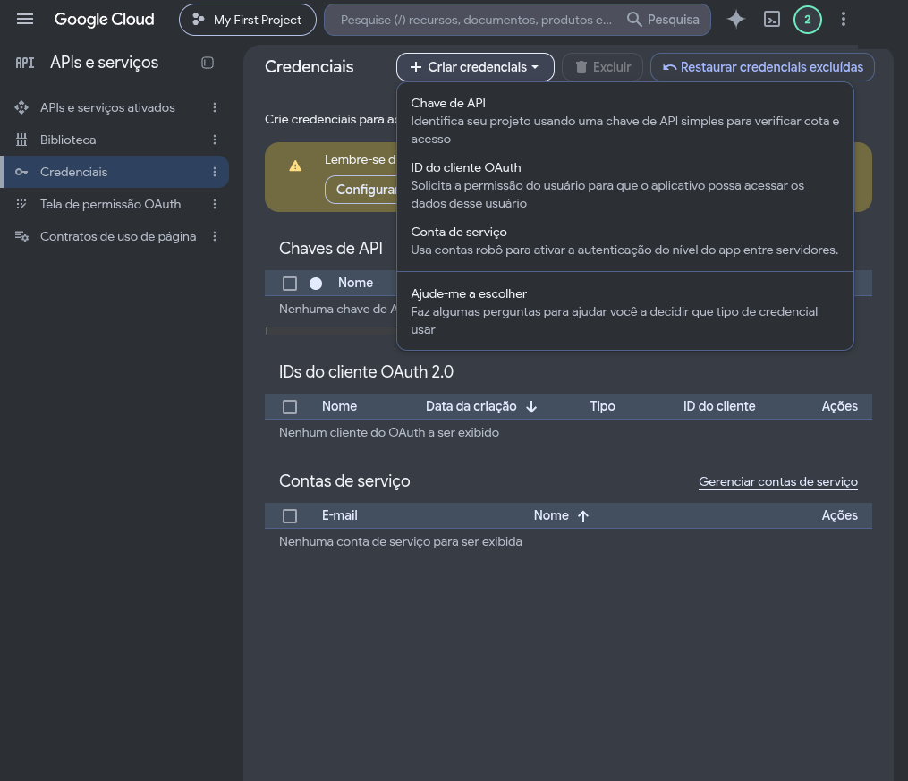

Se escolher **Ajude-me a escolher**, marque **Google Drive API** e **Dados do usuário** (*User data*):

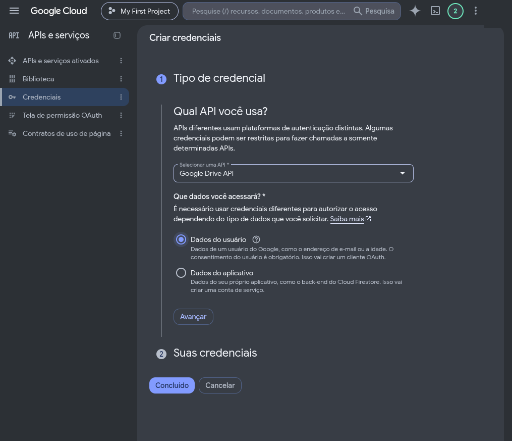

3. Se aparecer o aviso *"Para criar um ID do cliente OAuth, primeiro é preciso configurar sua tela de permissão"*, clique em **Configurar tela de consentimento**:

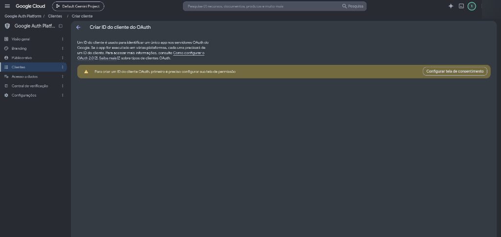

4. Na tela seguinte (**Branding**), clique em **Vamos começar** para abrir a configuração:


### Passo 3: Configurar a Tela de permissão OAuth (primeira vez do projeto)
Se for a primeira credencial do projeto, o Google pede a configuração da tela de consentimento (**Google Auth Platform**):
1. Em **Informações do app**, coloque o nome (por exemplo, `Custódia`) e seu e-mail de suporte. Clique em **Avançar**.
2. Em **Público**, escolha **Externo** (*External*) e clique em **Avançar**.
3. Em **Dados de contato**, informe seu e-mail novamente e clique em **Avançar**.
4. Aceite os termos e clique em **Criar**.

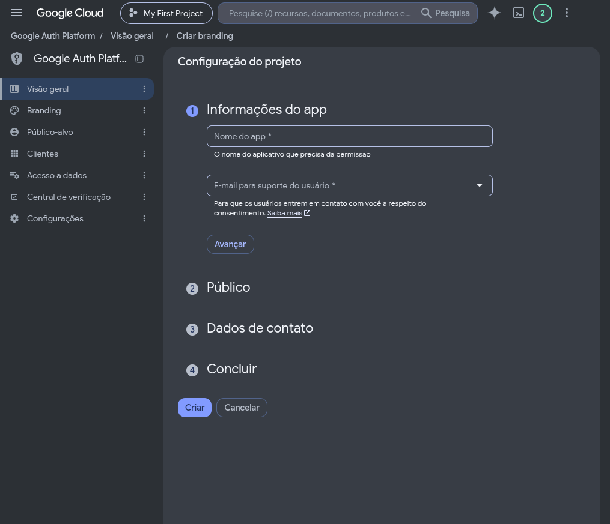

### Passo 4: Adicionar seu e-mail em Usuários de teste (obrigatório)
Enquanto o aplicativo estiver em modo **Testando** (*Testing*), o Google bloqueia logins (`Erro 403: access_denied`) de qualquer conta fora da lista de testadores.
1. No menu esquerdo do **Google Auth Platform**, clique em **Público-alvo** ([abrir página](https://console.cloud.google.com/auth/audience)).
2. Desça até **Usuários de teste** e clique em **+ Add users**:


3. Informe o endereço Google que você vai usar no Custódia e clique em **Salvar**:

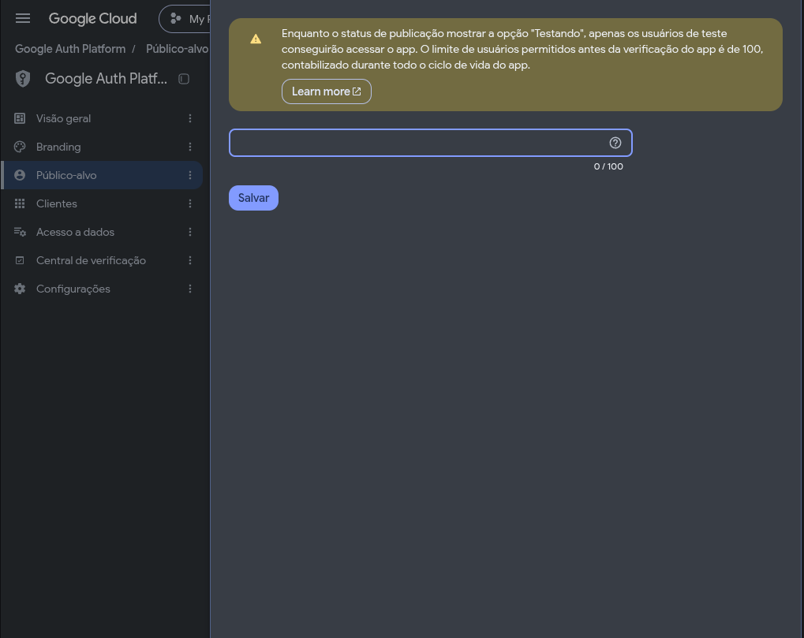

### Passo 5: Selecionar "App para computador" e baixar o JSON
1. No menu esquerdo, clique em **Clientes** e depois em **+ Criar cliente**:

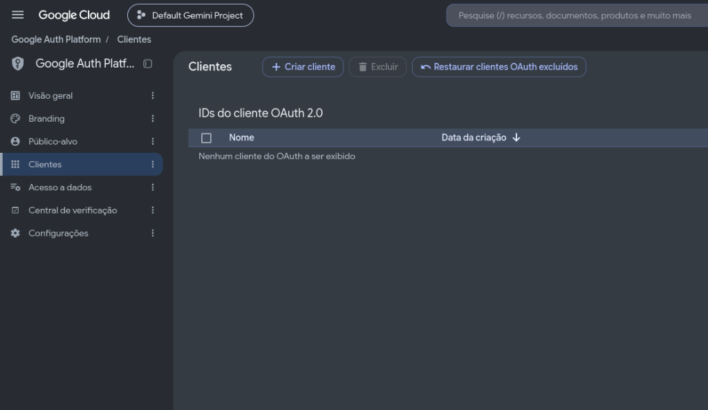

2. Em **Tipo de aplicativo**, selecione **App para computador** (*Desktop app*):

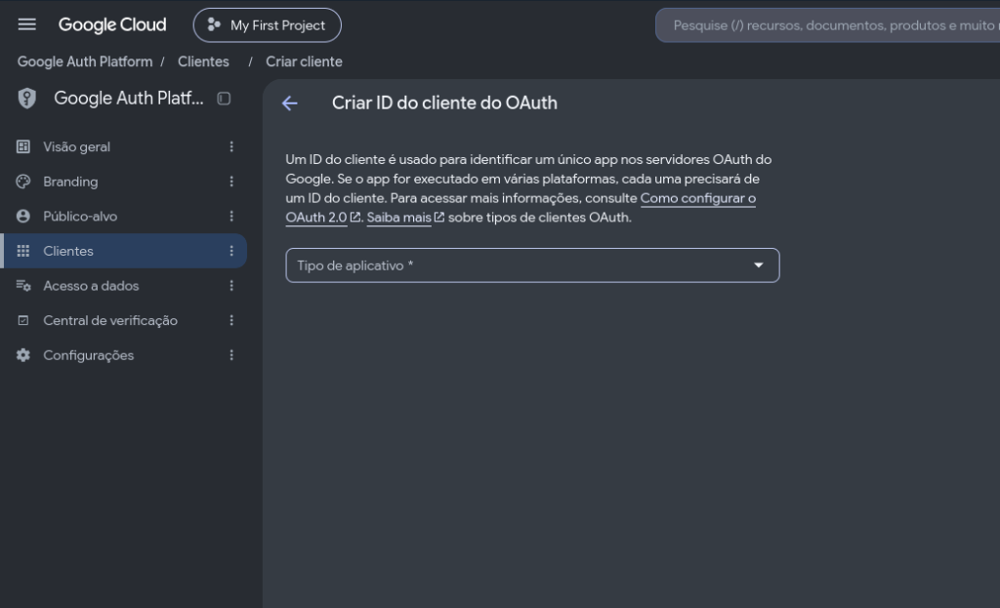

3. Coloque `Custódia` no campo **Nome** e clique em **Criar**.
4. Na janela **Cliente OAuth criado**, clique em **Baixar o JSON** (`client_secret_...json`):

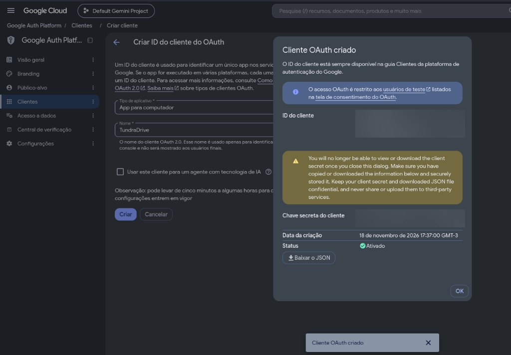

### Passo 6: Importar no Custódia e conectar
1. Abra o Custódia (em **Configurações** o app já detecta automaticamente arquivos em `~/Downloads` e também aceita arrastar e soltar o `.json`, ou use o cartão no rodapé da barra lateral).
2. Importe o JSON baixado e clique em **Conectar**.
3. No navegador oficial do Google que abrir:
   - Escolha a conta cadastrada no **Passo 4**:


   - Na tela *"O Google não verificou este app"*, clique em **Continuar**:


   - Confirme o acesso ao Google Drive clicando em **Continuar**:

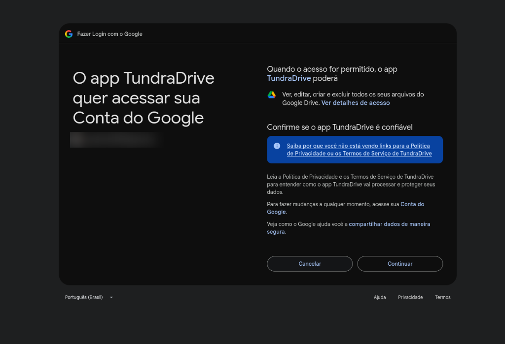

4. Depois de autorizar, use **Meus Arquivos** para navegar, criar pastas, enviar arquivos e personalizar pastas com o botão direito, e **Pastas de Sincronização** para mapear diretórios do PC ao Google Drive.

## Segurança e Privacidade

- **Isolamento local e permissões restritas (`0700` / `0600`):**
  - `~/.config/custodia/settings.json`: preferências gerais e personalizações visuais de pastas.
  - `~/.config/custodia/contas/<email>/`: diretório organizado por conta contendo `credentials.json`, `conta.json` e `pastas-sincronizadas.json` com acesso restrito ao usuário (`0600`).
  - `~/.local/share/custodia/tokens/`: tokens OAuth2 armazenados localmente com permissão `0600`.
  - `~/.local/share/custodia/custodia.db`: banco SQLite local com mapeamentos, metadados e logs de atividade.
- **Como os tokens são renovados:** o SDK oficial do Google utiliza o `refresh_token` salvo localmente (`0600`) para obter novos `access_token` temporários diretamente com o endpoint OAuth2 do Google, sem intervenção manual nem armazenamento de senha.
- **O JSON OAuth não contém sua senha:** o `client_secret_*.json` identifica apenas o ID de aplicativo criado por você no Google Cloud Console; sua senha é digitada apenas na página oficial de login do Google no navegador.
- **O que acontece ao revogar/desconectar uma conta:** o token local é invalidado/removido, o diretório `~/.config/custodia/contas/<email>/` tem a sessão encerrada e você escolhe explicitamente na janela de confirmação se deseja manter ou excluir também as pastas configuradas vinculadas àquele e-mail.
- **Superfície da API local:** o servidor REST embarcado escuta exclusivamente em `127.0.0.1:5080` (nunca em `0.0.0.0`) e **não deve ser exposto para fora do dispositivo** (ex.: via proxy reverso ou túnel público).
- **Como remover completamente todos os dados locais:**
  ```bash
  ./install-custodia.sh --uninstall
  rm -rf ~/.config/custodia ~/.local/share/custodia ~/.cache/custodia
  ```

## API REST Local (`127.0.0.1:5080`) e Agentes de IA

Guia completo com exemplos, schemas de Function Calling e cliente Python: **[Custodia-API.pdf](Custodia-API.pdf)** e **[docs/API.md](docs/API.md)**.

- `GET /api/v1/status`: conta ativa, uso de cota, transferências e pastas sincronizadas.
- `GET /api/v1/openapi.json`: especificação OpenAPI 3.0.3 para autodescoberta por agentes de IA.
- `POST /api/v1/sync/trigger`: dispara sincronização total ou por `folderId` (`{"folderId": "...", "waitForCompletion": false}`).
- `GET /api/v1/files/search?q=relatorio&includeRemote=true`: busca no SQLite local e opcionalmente no Drive remoto.
- `GET /api/v1/files/list?folderId=root`: lista pastas e arquivos no Drive.
- `GET /api/v1/files/trash?limit=50`: lista itens na Lixeira do Drive.
- `POST /api/v1/folders`: cria uma pasta no Drive (`{"name": "MinhaPasta", "parentFolderId": "root"}`).
- `POST /api/v1/files/upload`: envia um arquivo local para o Drive (`{"localPath": "/caminho/arquivo.pdf", "remoteFolderId": "root"}`).
- `POST /api/v1/files/download`: baixa um arquivo do Drive (`{"remoteFileId": "...", "destinationPath": "/caminho/destino.pdf"}`).
- `POST /api/v1/files/{remoteFileId}/move`: move de pasta e/ou renomeia (`{"targetFolderId": "...", "newName": "novo-nome.txt"}`).
- `POST /api/v1/files/{remoteFileId}/trash`: envia um item para a Lixeira do Drive.
- `POST /api/v1/files/{remoteFileId}/restore`: restaura um item da Lixeira.
- `DELETE /api/v1/files/{remoteFileId}?permanent=true`: apaga definitivamente (ou envia para a Lixeira se omitir `permanent=true`).
- `GET /api/v1/transfers`: lista transferências ativas e recentes.
- `GET /api/v1/logs?limit=50`: consulta os logs de sincronização e ações.

<details>
<summary>Para desenvolvedores: compilar pelo código-fonte e estrutura do projeto</summary>

### Requisitos e execução

Instale o SDK `.NET 10.0` (`sudo dnf install dotnet-sdk-10.0` no Fedora ou `sudo apt install dotnet-sdk-10.0` no Pop!_OS/Ubuntu) e execute:

```bash
dotnet restore Custodia.sln
dotnet build Custodia.sln
dotnet test Custodia.sln
dotnet run --project src/Custodia.Desktop/Custodia.Desktop.csproj
```

Para gerar os pacotes `.AppImage` e `.rpm` (`x86_64`) localmente em `dist/`:

```bash
./packaging/linux/build-rpm.sh
./packaging/linux/build-appimage.sh
```

### Estrutura do código

- `src/Custodia.Core`: modelos, SQLite com Dapper (`~/.local/share/custodia/custodia.db`), cliente Google Drive v3, fluxo OAuth2 (`0600`), cliente de e-mail TundraLab (`AppsScriptMailerClient`), watcher local (`FileSystemWatcher`) e verificação MD5/SHA256.
- `src/Custodia.Api`: servidor ASP.NET Core Minimal API em `127.0.0.1:5080` para scripts locais e agentes de IA.
- `src/Custodia.Desktop`: interface Avalonia UI 11.3.8 (MVVM com `CommunityToolkit.Mvvm`), menu de contexto completo em Meus Arquivos, ícone dinâmico da bandeja e notificações D-Bus.
- `tests/Custodia.Tests`: suíte com 53 testes unitários xUnit.

</details>

## Licença e Propriedade Intelectual

**Software Proprietário (Source-Available).**  
**Todos os Direitos Reservados (All Rights Reserved)**  
Copyright © 2026 TundraLab e Gustavo Henrique Novaes Gomes (@GustaHerin).

- **Acesso ao Código-Fonte (Portfólio, Estudo e Auditoria):** Embora este repositório seja público — permitindo tecnicamente que usuários visualizem, clonem localmente ou criem *fork* no GitHub estritamente para visualização, leitura, estudo e avaliação técnica —, **não é código aberto (*open source*)**. Nenhuma permissão ou licença é concedida para copiar, reproduzir, modificar, adaptar, criar obras derivadas, sublicenciar, distribuir, publicar ou utilizar trechos do código-fonte (no todo ou em parte) em outros projetos (comerciais ou não) sem autorização prévia e expressa por escrito dos titulares.
- **Uso dos Binários Oficiais (`.AppImage` / `.rpm`):** Usuários finais recebem licença gratuita, não exclusiva, intransferível e revogável para baixar, instalar e executar os pacotes oficiais publicados em [Releases](https://github.com/TundraLab/Custodia/releases), exclusivamente para uso pessoal ou corporativo interno, sendo vedada a redistribuição (gratuita ou comercial), revenda, oferta como serviço (SaaS), modificação ou engenharia reversa fora dos limites expressos em lei.
- **Contribuições Externas, Marcas e Terceiros:** Eventuais sugestões, relatórios de erro ou Pull Requests concedem aos autores licença irrevogável e livre de royalties para incorporação ao Software; esta licença não autoriza o uso dos nomes **"TundraLab"**, **"Custódia"** ou da identidade visual, e bibliotecas de terceiros seguem suas respectivas licenças originais.

Consulte o texto integral e vinculante em [LICENSE](./LICENSE).
