# Como Configurar o Google Drive (`credentials.json`)

> 🌐 **Idioma / Language:** **🇧🇷 Português (atual)** | [🇺🇸 English](en/OAUTH_SETUP.md)

Para conectar sua conta diretamente ao Google sem servidores intermediários, crie suas credenciais OAuth2 Desktop no Google Cloud Console seguindo os passos abaixo.

---

## Passo 1: Ativar a Google Drive API

1. Abra o [Google Cloud Console (Google Drive API)](https://console.cloud.google.com/apis/library/drive.googleapis.com).
2. Crie ou selecione um projeto no topo da página.
3. Clique em **Ativar** (*Enable*). Depois de ativa, a tela mostra **API ativada** e o botão **Gerenciar**. *(Não é necessário ativar a Gmail API no projeto.)*

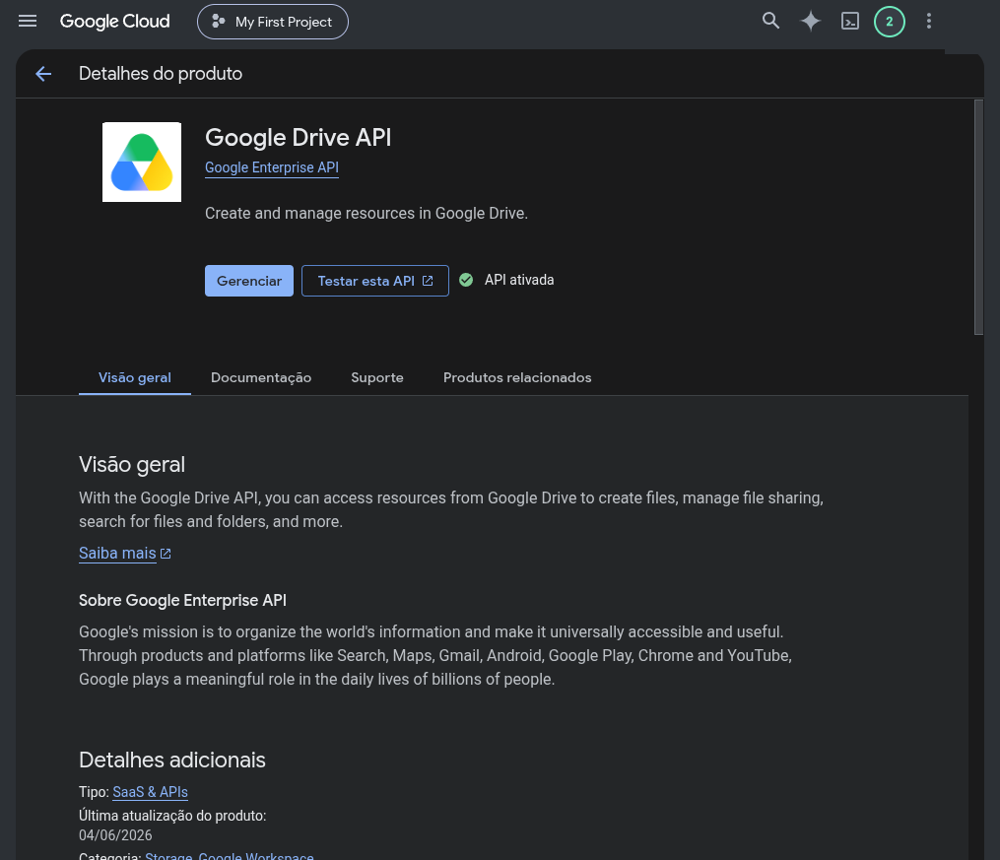

---

## Passo 2: Abrir o menu de Credenciais OAuth

1. No menu lateral esquerdo, acesse **APIs e serviços > Credenciais** (ou abra [Credenciais](https://console.cloud.google.com/apis/credentials)).
2. Clique em **+ Criar credenciais** no topo e escolha **ID do cliente OAuth**:

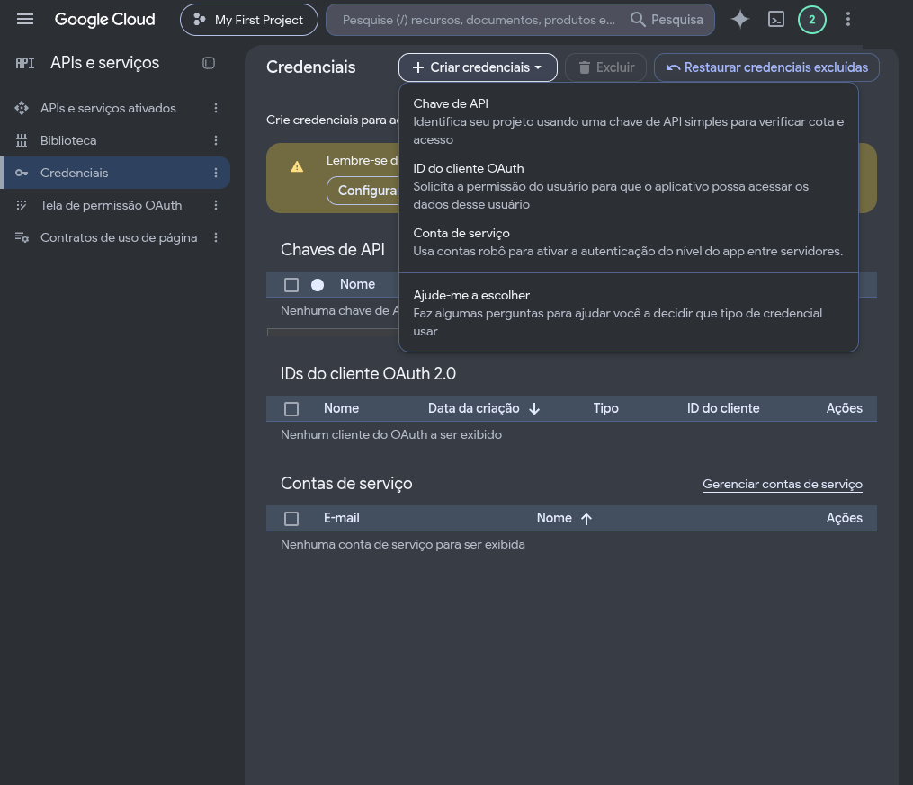

Se escolher **Ajude-me a escolher**, marque **Google Drive API** e **Dados do usuário** (*User data*):

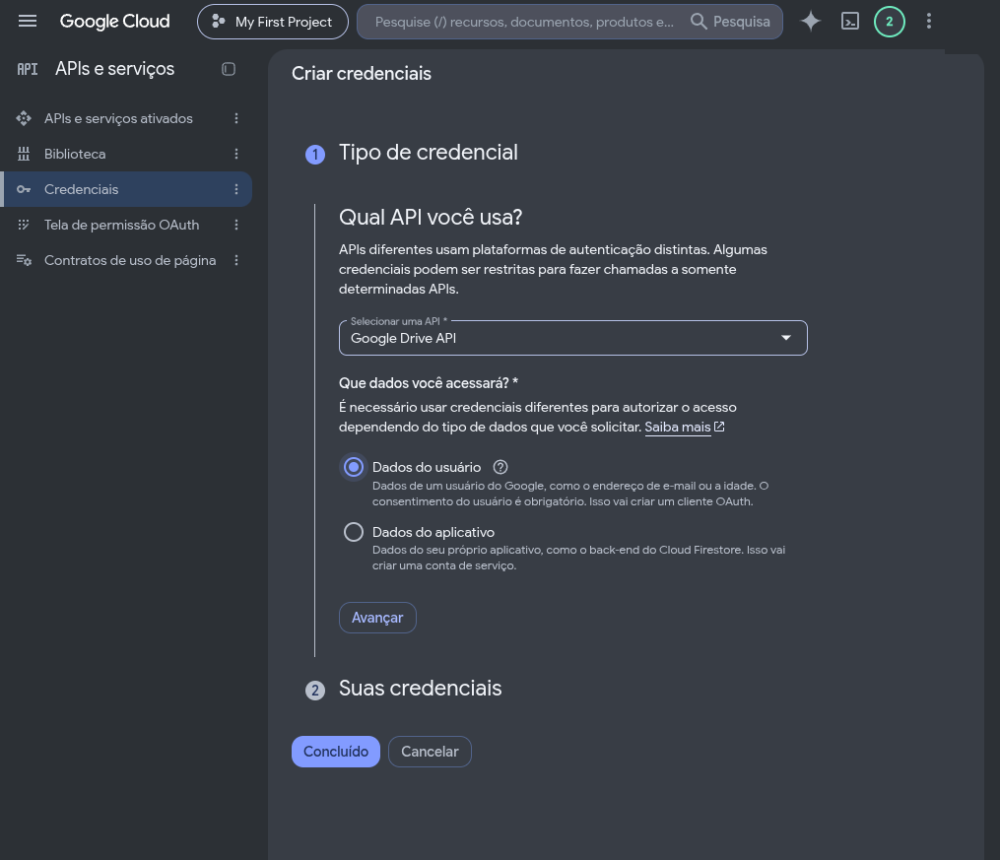

3. Se aparecer o aviso *"Para criar um ID do cliente OAuth, primeiro é preciso configurar sua tela de permissão"*, clique em **Configurar tela de consentimento**:

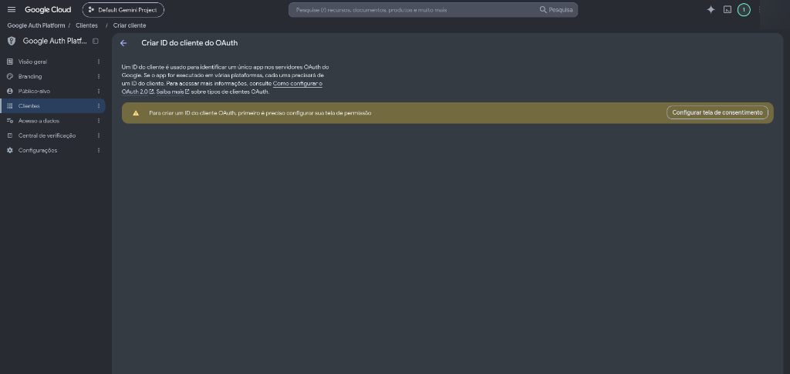

4. Na tela seguinte (**Branding**), clique em **Vamos começar** para abrir a configuração:

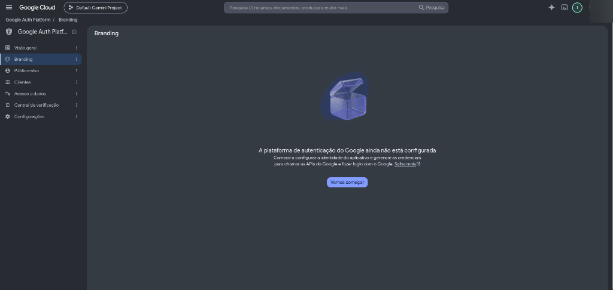

---

## Passo 3: Configurar a Tela de permissão OAuth (primeira vez do projeto)

Se for a primeira credencial do projeto, o Google pede a configuração da tela de consentimento (**Google Auth Platform**):

1. Em **Informações do app**, coloque o nome (por exemplo, `Custódia`) e seu e-mail de suporte. Clique em **Avançar**.
2. Em **Público**, escolha **Externo** (*External*) e clique em **Avançar**.
3. Em **Dados de contato**, informe seu e-mail novamente e clique em **Avançar**.
4. Aceite os termos e clique em **Criar**.

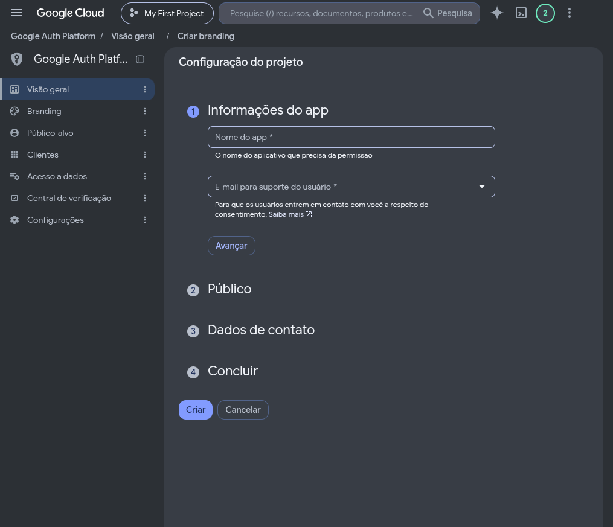

---

## Passo 4: Adicionar seu e-mail em Usuários de teste (obrigatório)

Enquanto o aplicativo estiver em modo **Testando** (*Testing*), o Google bloqueia logins (`Erro 403: access_denied`) de qualquer conta fora da lista de testadores.

1. No menu esquerdo do **Google Auth Platform**, clique em **Público-alvo** ([abrir página](https://console.cloud.google.com/auth/audience)).
2. Desça até **Usuários de teste** e clique em **+ Add users**:

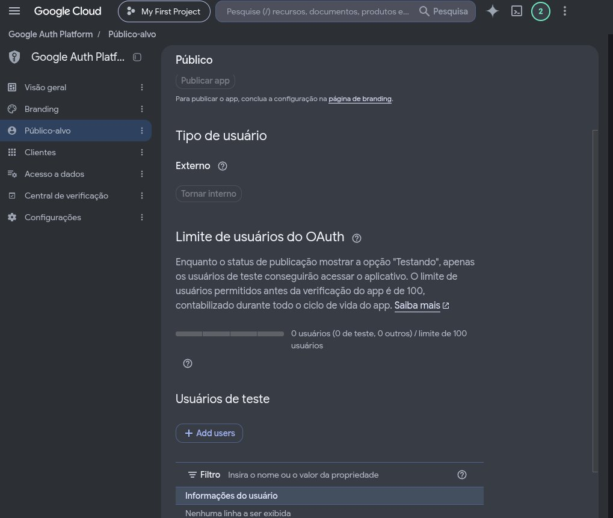

3. Informe o endereço Google que você vai usar no Custódia e clique em **Salvar**:

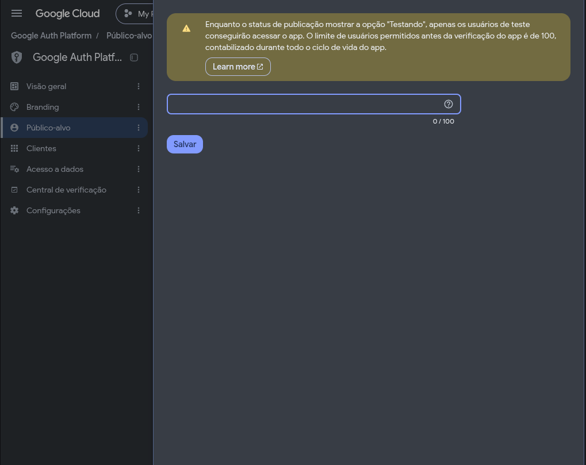

---

## Passo 5: Selecionar "App para computador" e baixar o JSON

1. No menu esquerdo, clique em **Clientes** e depois em **+ Criar cliente**:

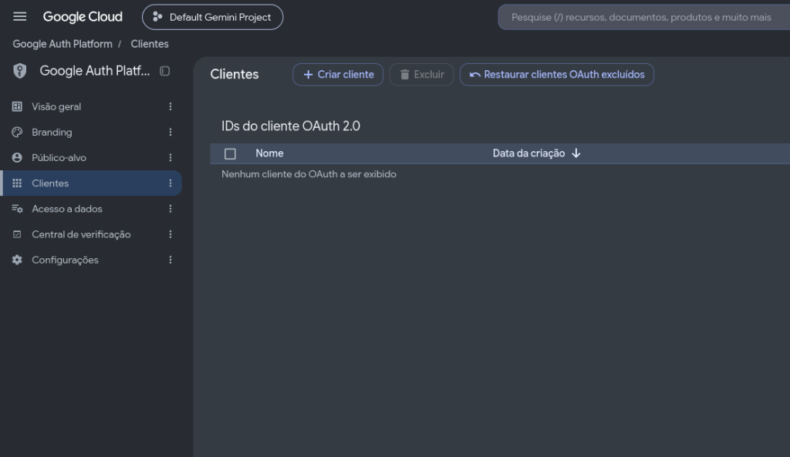

2. Em **Tipo de aplicativo**, selecione **App para computador** (*Desktop app*):

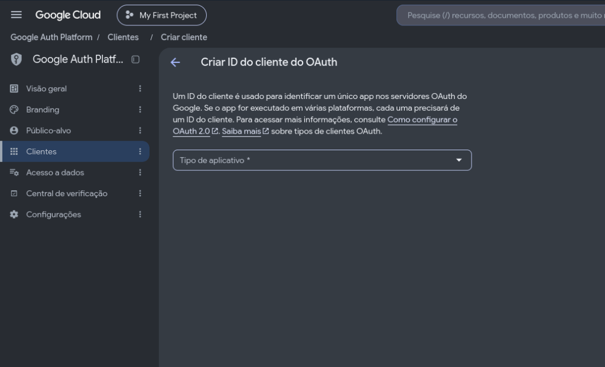

3. Coloque `Custódia` no campo **Nome** e clique em **Criar**.
4. Na janela **Cliente OAuth criado**, clique em **Baixar o JSON** (`client_secret_...json`):

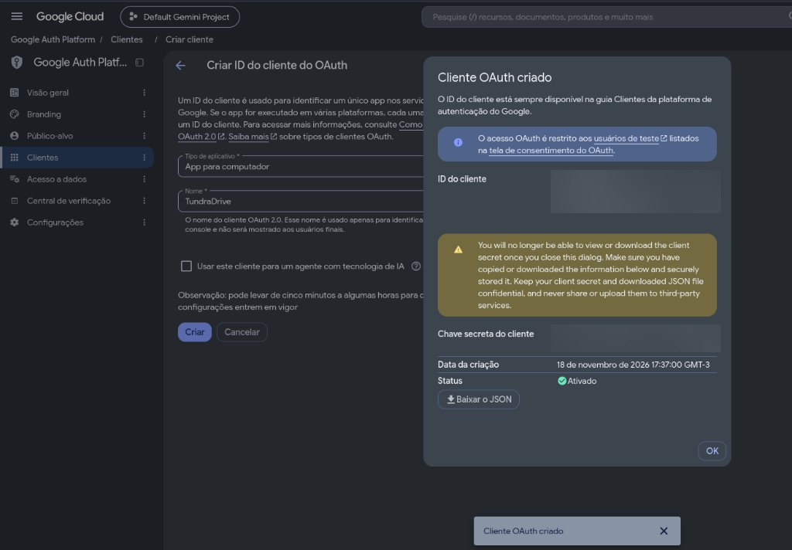

---

## Passo 6: Importar no Custódia e conectar

1. Abra o Custódia (em **Configurações** o app já detecta automaticamente arquivos em `~/Downloads` e também aceita arrastar e soltar o `.json`, ou use o cartão no rodapé da barra lateral).
2. Importe o JSON baixado e clique em **Conectar**.
3. No navegador oficial do Google que abrir:
   - Escolha a conta cadastrada no **Passo 4**:

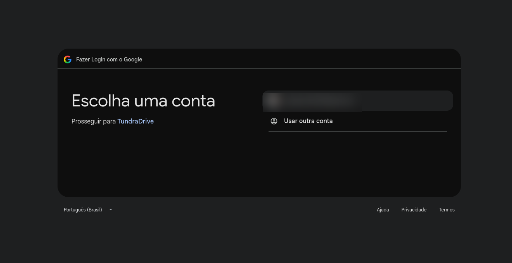

   - Na tela *"O Google não verificou este app"*, clique em **Continuar**:

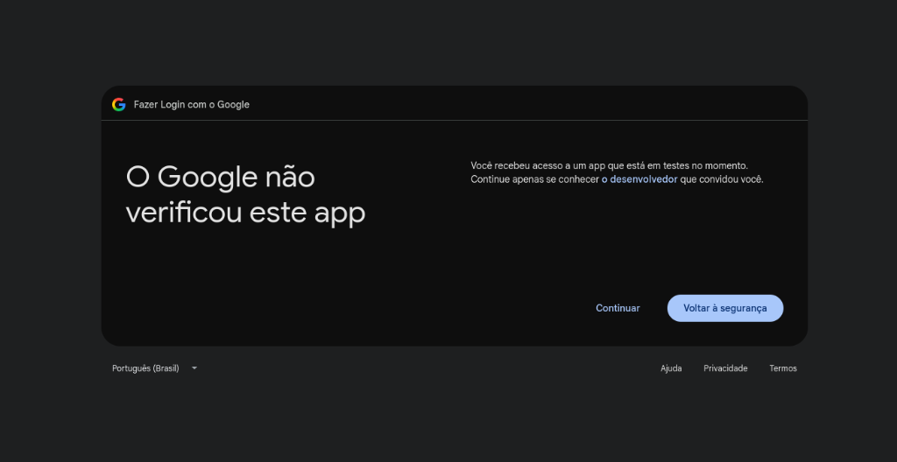

   - Confirme o acesso ao Google Drive clicando em **Continuar**:

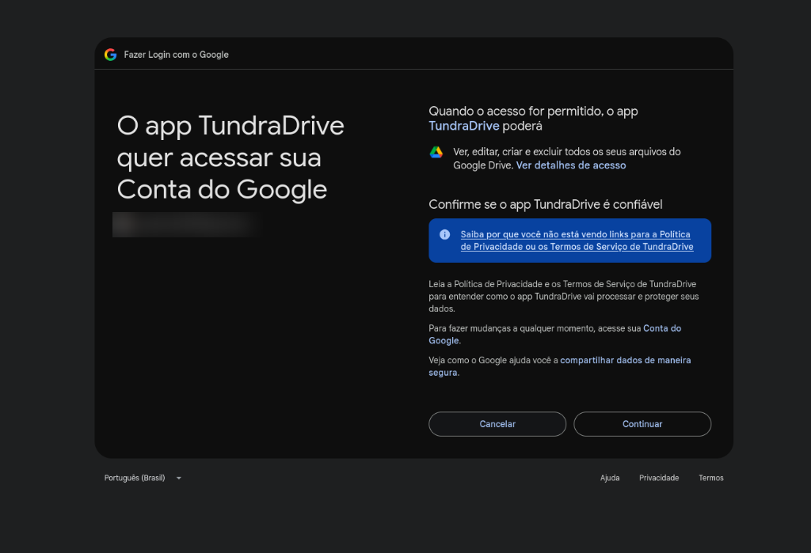

4. Depois de autorizar, use **Meus Arquivos** para navegar, criar pastas, enviar arquivos e personalizar pastas com o botão direito, e **Pastas de Sincronização** para mapear diretórios do PC ao Google Drive.
