# How to Configure Google Drive (`credentials.json`)

> 🌐 **Language / Idioma:** [🇧🇷 Português](../OAUTH_SETUP.md) | **🇺🇸 English (current)**

To connect your account directly to Google without intermediary servers, create your Desktop OAuth2 credentials in Google Cloud Console following the steps below.

---

## Step 1: Enable the Google Drive API

1. Open [Google Cloud Console (Google Drive API)](https://console.cloud.google.com/apis/library/drive.googleapis.com).
2. Create or select a project at the top of the page.
3. Click **Enable**. Once enabled, the screen shows **API enabled** and the **Manage** button. *(You do not need to enable the Gmail API in the project.)*

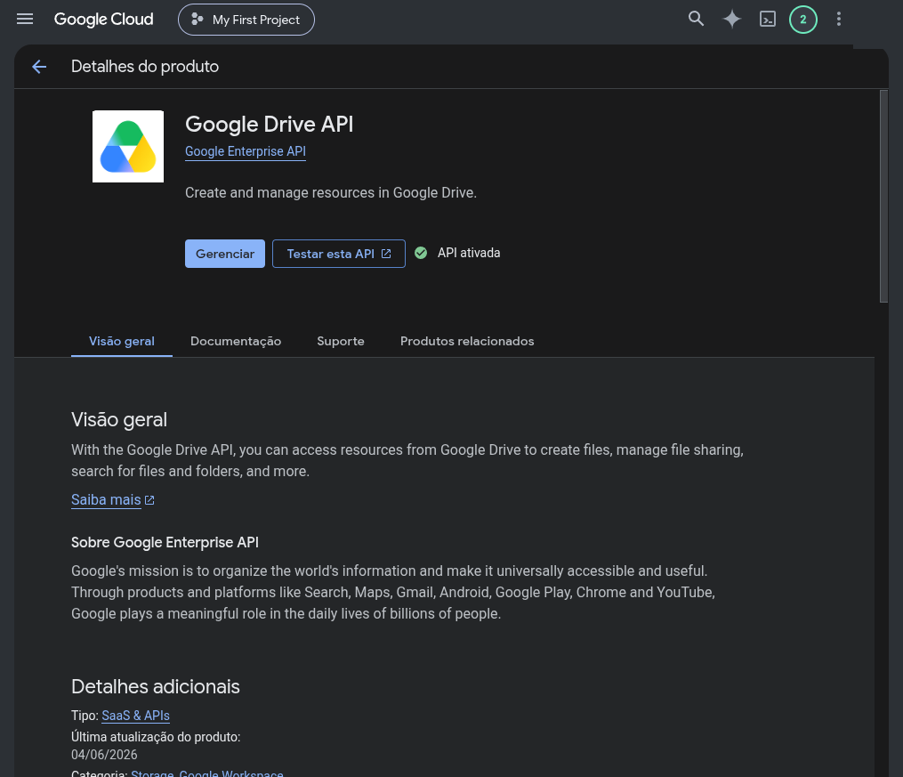

---

## Step 2: Open the OAuth Credentials menu

1. In the left sidebar, go to **APIs & Services > Credentials** (or open [Credentials](https://console.cloud.google.com/apis/credentials)).
2. Click **+ Create credentials** at the top and choose **OAuth client ID**:

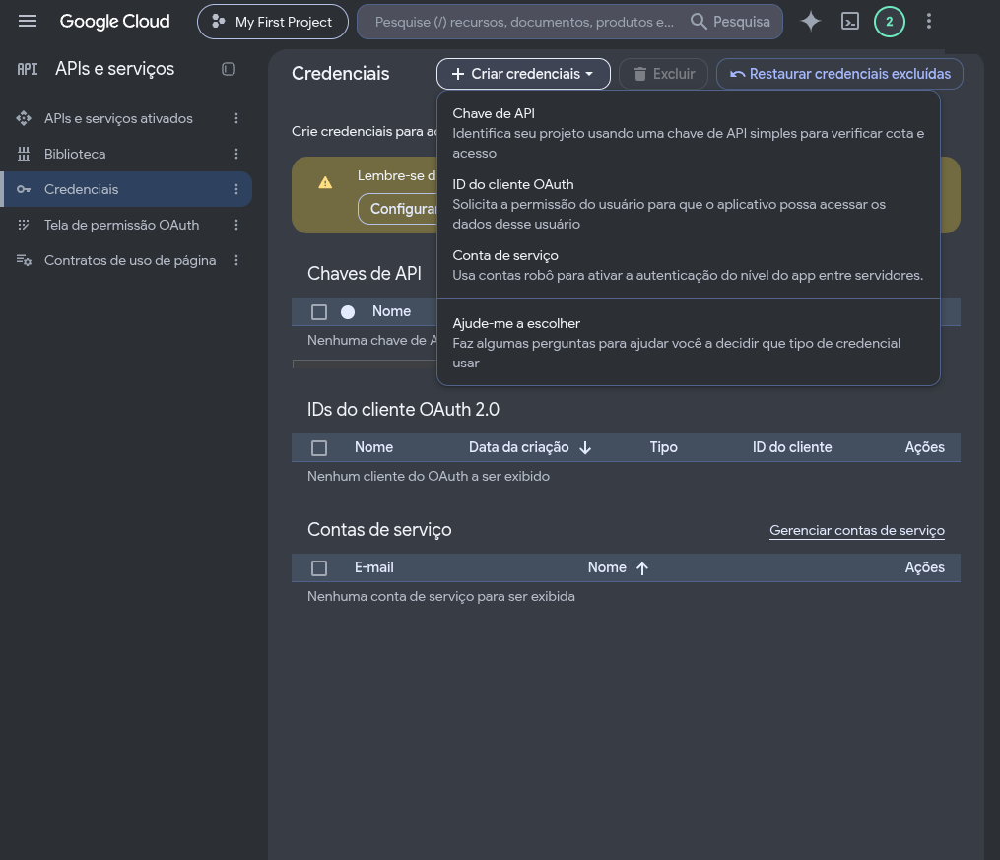

If you choose **Help me choose**, select **Google Drive API** and **User data**:

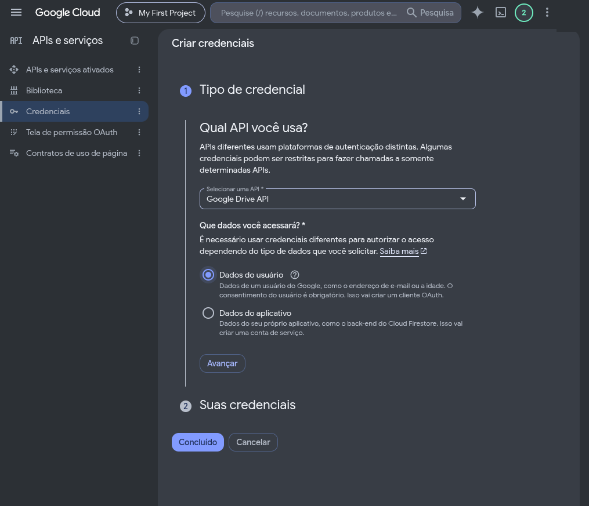

3. If the notice *"To create an OAuth client ID, you must first set a product name on the consent screen"* appears, click **Configure consent screen**:

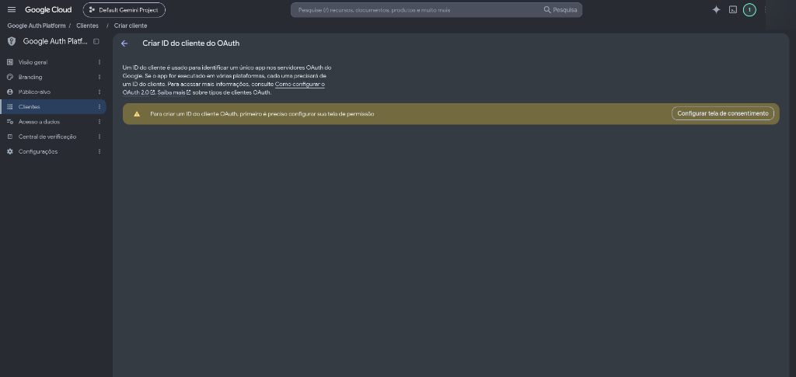

4. On the next screen (**Branding**), click **Get started** to open the setup:

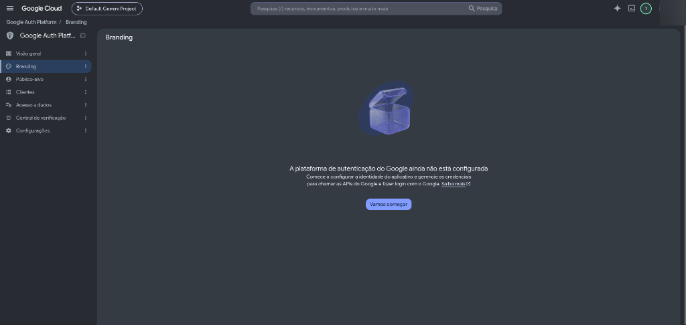

---

## Step 3: Configure the OAuth consent screen (first time for the project)

If this is the first credential in the project, Google asks you to configure the consent screen (**Google Auth Platform**):

1. Under **App information**, enter the name (for example, `Custódia`) and your support email. Click **Next**.
2. Under **Audience**, choose **External** and click **Next**.
3. Under **Contact information**, enter your email again and click **Next**.
4. Accept the terms and click **Create**.

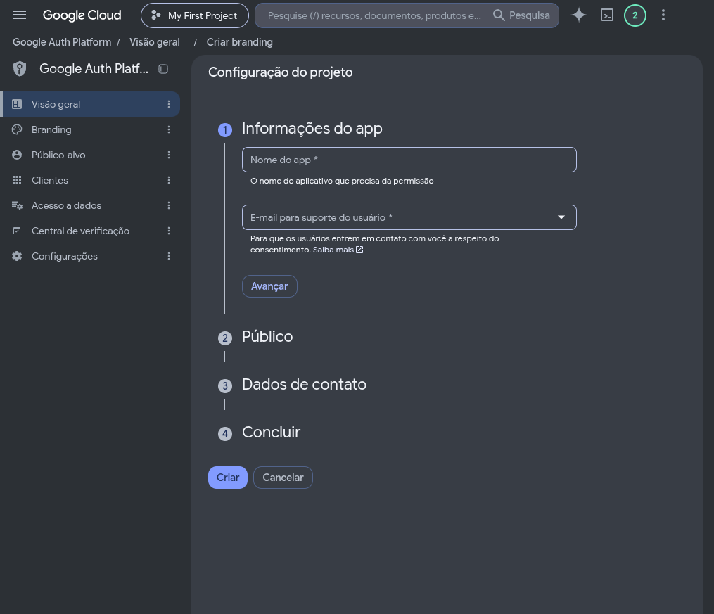

---

## Step 4: Add your email under Test users (required)

While the app is in **Testing** mode, Google blocks sign-ins (`Error 403: access_denied`) for any account outside the test users list.

1. In the left menu of **Google Auth Platform**, click **Audience** ([open page](https://console.cloud.google.com/auth/audience)).
2. Scroll down to **Test users** and click **+ Add users**:

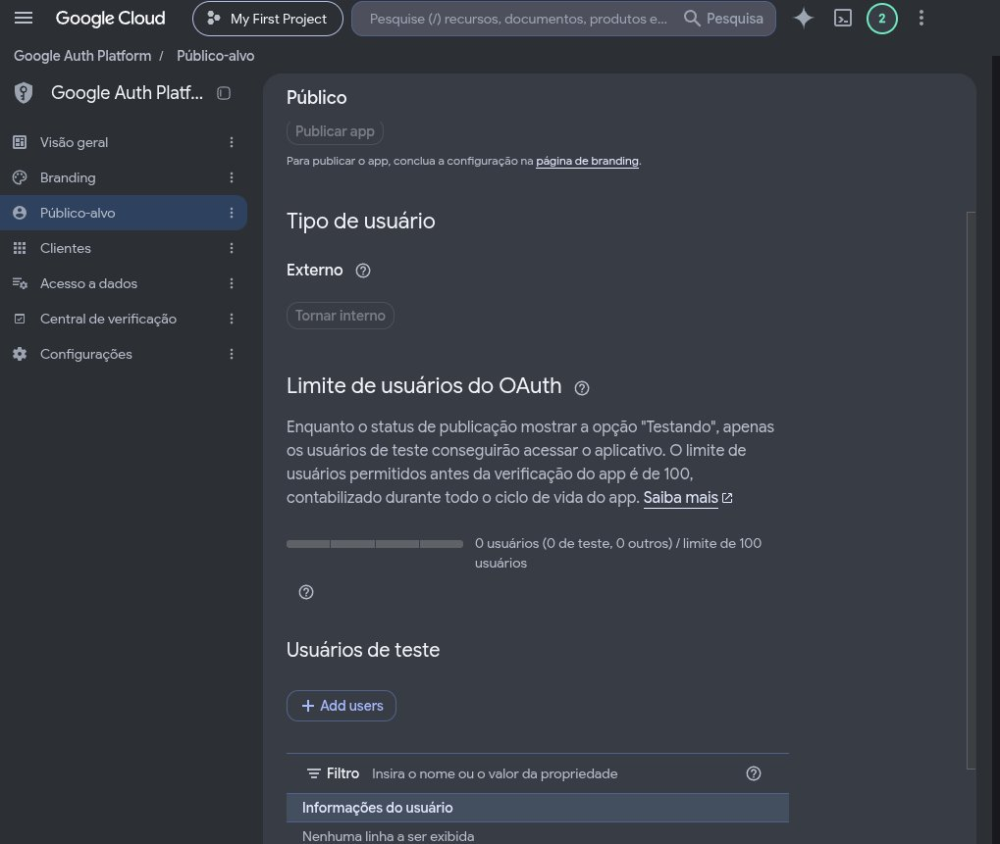

3. Enter the Google email address you will use in Custódia and click **Save**:

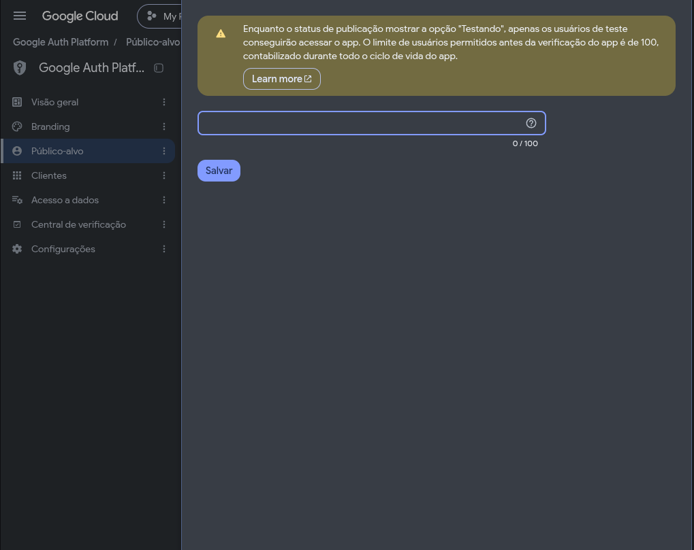

---

## Step 5: Select "Desktop app" and download the JSON

1. In the left menu, click **Clients** and then **+ Create client**:

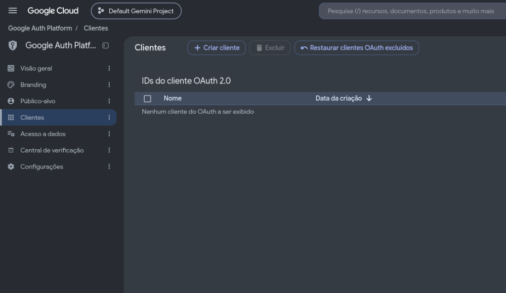

2. Under **Application type**, select **Desktop app**:

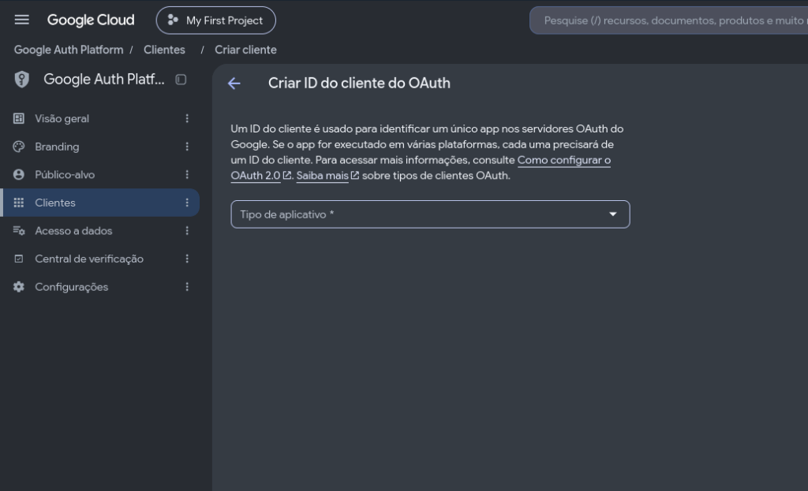

3. Enter `Custódia` in the **Name** field and click **Create**.
4. In the **OAuth client created** dialog, click **Download JSON** (`client_secret_...json`):

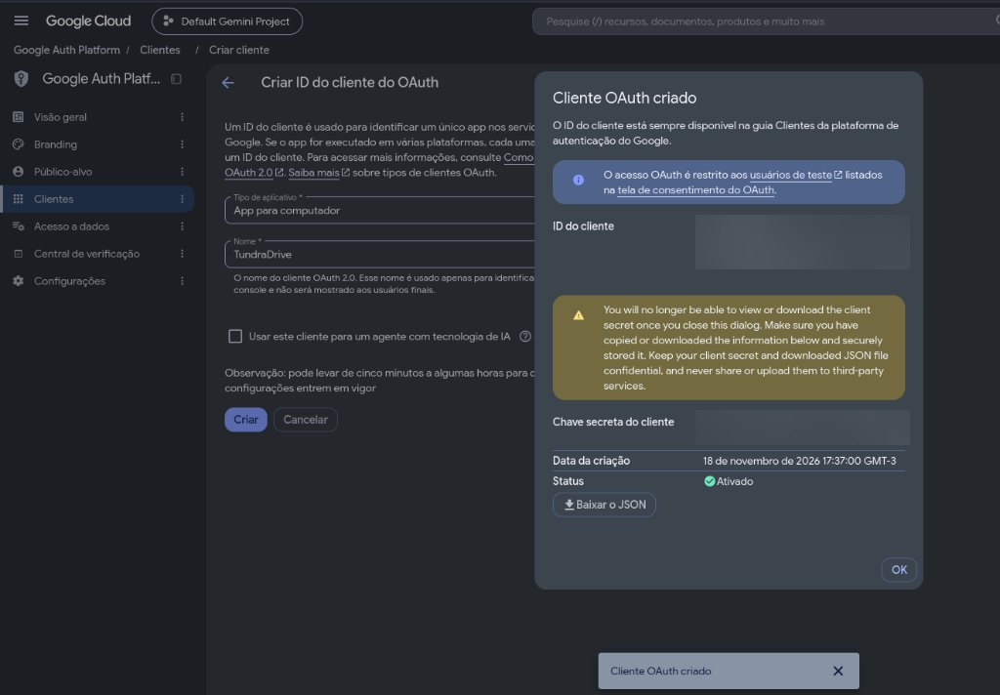

---

## Step 6: Import in Custódia and connect

1. Open Custódia (in **Settings**, the app automatically detects files in `~/Downloads` and also accepts drag-and-drop of the `.json`, or use the card at the bottom of the sidebar).
2. Import the downloaded JSON and click **Connect**.
3. In the official Google browser window that opens:
   - Choose the account registered in **Step 4**:

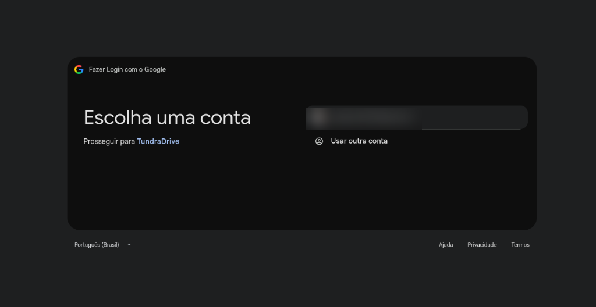

   - On the *"Google hasn't verified this app"* screen, click **Continue**:

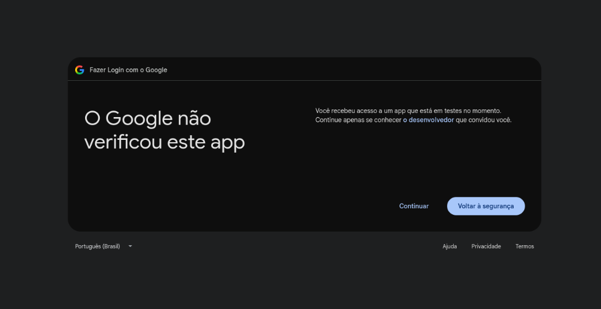

   - Confirm Google Drive access by clicking **Continue**:

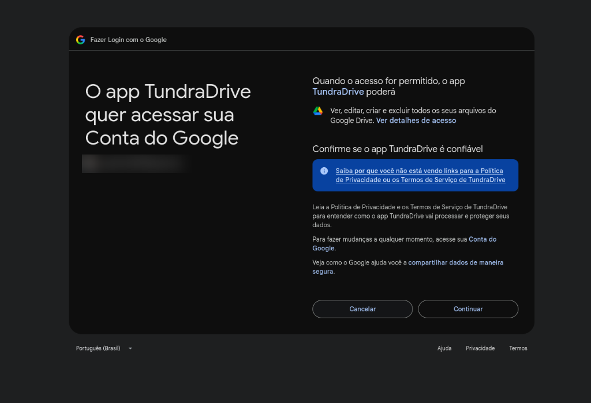

4. After authorizing, use **My Files** to browse, create folders, upload files, and customize folders with right-click, and **Sync Folders** to map PC directories to Google Drive.
