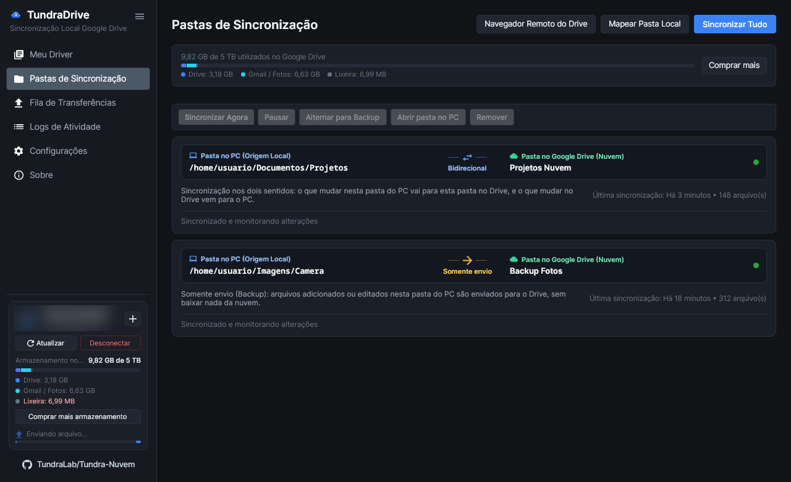

# Custódia v3.0.5

> 🌐 **Language / Idioma:** [🇧🇷 Português](../../README.md) | **🇺🇸 English (current)**


[](https://github.com/TundraLab/Custodia)
[](https://github.com/GustaHerin)
[](https://github.com/TundraLab/Custodia/releases)
[](../../tests/Custodia.Tests)
[](#systems-and-formats)
[](#systems-and-formats)
[](#systems-and-formats)
[](#installation)
[](https://dotnet.microsoft.com/)
[](https://avaloniaui.net/)
[](../../LICENSE)
[](PRIVACY.md)
[](TERMS.md)

> **In development since:** 2026  
> **Status:** stable, with official releases ([GitHub Releases](https://github.com/TundraLab/Custodia/releases))  
> **Platform:** Linux `x86_64`  
> **Goal:** secure and intuitive synchronization with Google Drive

**My files. Always safe.** Native Linux desktop client focused on folder synchronization, local backups, multimedia management, and privacy-first local automation directly with Google Drive.

## Quality

- **Build & distribution:** clean `.NET 10.0` compilation for Linux `x86_64` with native `.rpm` and `.AppImage` packaging verified by SHA-256
- **Test suite:** **66 xUnit unit tests passing (`0` failures)** covering sync engine, transfer queue, SQLite persistence, OAuth2 account isolation, updater, support diagnostics sanitization, terms/privacy acceptance, and lifecycle emails
- **Primary platform:** Linux `x86_64` (Fedora Workstation/KDE, Pop!_OS GNOME/COSMIC, and KDE Plasma 5/6)
- **Technical documentation:** live OpenAPI `3.0.3` (`GET /api/v1/openapi.json`), [API.md](API.md), [Custodia-API.en.pdf](Custodia-API.en.pdf), and full history in [CHANGELOG.md](../../CHANGELOG.md)

## Documentation

> Available in **[🇺🇸 English](README.md)** and **[🇧🇷 Português](../../README.md)**.

| Guide | Contents |
| :--- | :--- |
| **[OAuth2 Setup](OAUTH_SETUP.md)** | Illustrated step-by-step guide to create `credentials.json` in Google Cloud Console and connect your account |
| **[Linux Compatibility](COMPATIBILITY.md)** | Matrix of tested vs. supported features across GNOME, KDE Plasma 5/6, COSMIC, Wayland, and X11 |
| **[Security & Privacy](SECURITY.md)** | BYO-OAuth2 model, `0700`/`0600` permissions, token refresh, and local API surface |
| **[Frequently Asked Questions (FAQ)](FAQ.md)** | Offline mode, conflict policy, Trash recovery, multiple accounts, and complete removal |
| **[Troubleshooting](TROUBLESHOOTING.md)** | Diagnostics for `.rpm`, `.AppImage`/FUSE, GNOME tray icon, D-Bus, `403` error, and previews |
| **[Local REST API](API.md)** | Endpoints on `127.0.0.1:5080`, OpenAPI `3.0.3`, Python examples, and AI agent integration |

## Visual Preview


- **[Watch promo video](../videos/custodia-divulgacao.mp4)** (`MP4`, 21 MB)

<details>
<summary>View all 6 individual screens</summary>

| Screen | Preview |
| :--- | :--- |
| **My Files** |  |
| **Sync Folders** |  |
| **Transfer Queue** |  |
| **Activity Logs** |  |
| **Settings** |  |
| **About** |  |

</details>

## Systems and Formats

- Tested on **Fedora** and **Pop!_OS** (including modest hardware), with support for **GNOME**, **COSMIC**, and **KDE Plasma 5/6** — see the full matrix in **[COMPATIBILITY.md](COMPATIBILITY.md)**.
- **Distributed formats:** native **`.rpm`** package (Fedora / RHEL / openSUSE) and standalone **`.AppImage` (`x86_64`)** with the `.NET 10` runtime bundled (Pop!_OS, Ubuntu, Debian, and other Linux distros, without installing `.NET` dependencies), both verified by **SHA-256** (`SHA256SUMS.txt`).

## What the App Does

- **My Files with full right-click context menu:** browse **My Drive**, **Local Folders**, and **Trash** in List or Grid mode with thumbnails, multi-selection (`Ctrl + Click`, `Shift + Click`, `Ctrl + A`), drag-and-drop or multi-file upload, and context menus on both files/folders and empty areas (**New Folder**, **Upload File**, **Customize folder**, **Refresh**, **Back**, **Select All**, and **Move to Trash** highlighted in red).
- **Folder customization (color, symbol, and nickname):** customize directly via right-click in **My Files** or on the **Sync Folders** tab, with colors and icons preserved across sessions.
- **Built-in multimedia preview:** images, videos (thumbnail, duration, and player), audio (waveform and built-in player), PDFs with page navigation, Office documents (`DOCX`, `XLSX`, `PPTX`, `ODT`, `ODS`, `ODP`), Google Workspace files, and text/code.
- **Non-blocking queue and dynamic tray icon:** queue with no 200-item cap, expanded history, animated banners on upload/download failures, and a pulsing top-bar icon that grows and switches color/symbol by state (`↑` blue upload, `↓` green download, `✕` red delete, `↻` syncing, and `!` error), synchronized with the native menu without freezing stale statuses.
- **Flexible per-folder sync:** **Two-Way (`PC <-> Drive`)** or **One-Way Backup (`PC -> Drive`)** mode, multiple mappings preserving names and empty subfolders, MD5/SHA256 hash validation, conflict policy, ignore patterns, and continuous real-time local change monitoring.
- **Safe Trash:** deletions in synced folders send items to Google Drive Trash (or to the system FreeDesktop Trash compatible with GNOME Files and KDE Dolphin); permanent deletion only happens manually inside Trash.
- **Advanced multi-account management:** dedicated, human-readable folders per email in `~/.config/custodia/contas/<email>/` (`credentials.json`, `conta.json`, and `pastas-sincronizadas.json`), automatic detection of `client_secret_*.json` in `~/Downloads`, drag-and-drop import in Settings, `Project ID` / `Client ID` inspection, fast switching, reconnection, and automatic folder preservation when removing/re-adding an account (with an explicit option to delete the configuration).
- **TundraLab welcome and revocation notices:** optional automatic emails sent from **`contato.tundralab@gmail.com`** via TundraLab's dedicated service, without needing to enable the Gmail API on users' OAuth projects.
- **Support and updates on the About tab:** scheduled release check with offline protection, unified form with **Bug / Error** (`&labels=bug`) vs **Suggestion** (`&labels=enhancement`) selector, optional sanitized technical diagnostics for bug reports (preview via **View data** and safe URL limit preserving the full log via **Copy text**).
- **Language, zoom, RAM, and sound:** PT-BR and EN-US, zoom from 100% to 300% (`Ctrl++`, `Ctrl+-`, `Ctrl+0`), periodic RAM cleaner, and 6 synthesized D-Bus notification ringtones (or silent mode).

## Architecture

```text
  Desktop UI (Avalonia UI — MVVM, System Tray & Notifications)
                          │
                          ▼
   Sync Core (Sync Engine, OAuth2, Hashes & Updater)
     ├──▶ Google Drive API v3 (drive scope directly from the user's machine)
     ├──▶ Local SQLite (~/.local/share/custodia/custodia.db)
     ├──▶ TundraLab Email Service (contato.tundralab@gmail.com)
     └──▶ Local REST API (ASP.NET Core + OpenAPI 3.0.3 on 127.0.0.1:5080)
```

- **Desktop Layer:** Avalonia UI 11.3.8 interface with MVVM pattern, enforced single instance, dynamic tray icon via D-Bus/AppIndicator, and multimedia preview.
- **Sync Core:** two-way and one-way sync engine, conflict resolution, MD5/SHA256 integrity validation, continuous local watcher, per-account OAuth2 vault, and official update checker.
- **Local REST API:** embedded HTTP Minimal API server on local *loopback* (`127.0.0.1`) exposing REST endpoints and an OpenAPI `3.0.3` schema for safe integration with local scripts and AI agents.
- **Data Flow:** local or remote changes are compared against state persisted in SQLite and synced directly with Google Drive API v3, updating the transfer queue and local logs in real time.

## Technical Decisions

- **C# and `.NET 10.0`:** chosen for strong typing, solid controlled async concurrency support, and stable self-contained publishing for Linux `x86_64`.
- **Avalonia UI (`11.3.8`):** chosen to deliver a fluid, consistent UI across GNOME, COSMIC, and KDE Plasma (X11 and Wayland) with low memory footprint and testable MVVM architecture.
- **SQLite + Dapper:** chosen for a lightweight, transactional (ACID), low-latency local relational database without requiring an external service installed on the user's PC.
- **Direct Google Drive API v3:** chosen so files and tokens travel strictly between the user's computer and Google Drive, with no intermediary servers.
- **AppImage and RPM (`x86_64`):** `.rpm` provides native integration on Fedora and derivatives, while `.AppImage` ensures universal execution on Ubuntu/Pop!_OS and other distros without requiring an external SDK or runtime.
- **Local API on `127.0.0.1:5080`:** restricts automations and AI agents to the local machine, allowing file operations without exposing OAuth tokens or opening external network ports.

## Sync Modes

Each mapped folder can operate in **Two-Way Mirror (`PC <-> Drive`)** or **One-Way Backup (`PC -> Drive`)**:

| Action taken | Two-Way (`PC <-> Drive`) | One-Way Backup (`PC -> Drive`) |
| :--- | :--- | :--- |
| Deleted on **PC** | Moves to Drive Trash | Moves to Drive Trash |
| Deleted on **Drive** | Moves to PC Trash | Stays saved on PC and is not re-uploaded |
| Added on **Drive** | Downloads to PC | Does not download to PC |
| Added/edited on **PC** | Uploads to Drive | Uploads to Drive |

## Installation

### 1. Interactive Terminal Installer (`Custódia by TundraLab` - Recommended)

Detects your Linux distribution, downloads only your chosen format (**`.rpm`** or **`.AppImage`**), validates **SHA-256**, installs icons/shortcuts, and configures autostart:

```bash
curl -fsSL https://github.com/TundraLab/Custodia/releases/latest/download/Custodia-Installer-x86_64.sh -o install-custodia.sh
chmod +x install-custodia.sh
./install-custodia.sh
```

### 2. Direct Package Download via Terminal (optional)

- **AppImage (`x86_64`, runs directly without installing):**
  ```bash
  curl -fLO https://github.com/TundraLab/Custodia/releases/latest/download/Custodia-3.0.5-x86_64.AppImage
  chmod +x Custodia-3.0.5-x86_64.AppImage
  ./Custodia-3.0.5-x86_64.AppImage
  ```
- **Fedora / RHEL / openSUSE (`.rpm`):**
  ```bash
  curl -fLO https://github.com/TundraLab/Custodia/releases/latest/download/Custodia-3.0.5-1.x86_64.rpm
  sudo dnf install -y ./Custodia-3.0.5-1.x86_64.rpm
  ```

<details>
<summary>Advanced options (installer flags, media extras, and GNOME tray icon)</summary>

- **`install-custodia.sh` flags:**
  - `./install-custodia.sh --update`: detects your current installation (`.rpm` or `.AppImage`) and updates to the latest release.
  - `./install-custodia.sh --rpm`: downloads, validates `SHA-256`, and installs the `.rpm`.
  - `./install-custodia.sh --appimage`: downloads, validates `SHA-256`, and installs the user-integrated `.AppImage`.
  - `./install-custodia.sh --download-only`: downloads `.rpm`, `.AppImage`, and `SHA256SUMS.txt` into the current directory.
  - `./install-custodia.sh --uninstall`: removes the local or `.rpm` installation while keeping your settings.
- **AppImage without FUSE:** `./Custodia-3.0.5-x86_64.AppImage --appimage-extract-and-run`
- **Optional packages for full preview (PDF, Office, audio, and video):**
  - Fedora: `sudo dnf install poppler-utils ghostscript ffmpeg libreoffice ImageMagick`
  - Pop!_OS / Ubuntu: `sudo apt install poppler-utils ghostscript ffmpeg libreoffice imagemagick`
- **Cloud icon on the GNOME Workstation top bar** *(works natively on KDE Plasma and Pop!_OS)*:
  ```bash
  sudo dnf install gnome-shell-extension-appindicator
  gsettings set org.gnome.shell enabled-extensions "['appindicatorsupport@rgcjonas.gmail.com']"
  ```
  *(Log out and log back in to GNOME after enabling for the first time.)*

</details>

## How to Configure Google Drive (`credentials.json`)

To connect your account directly to Google without intermediary servers, create your Desktop OAuth2 credentials in Google Cloud Console:

1. Enable the **Google Drive API** in your Google Cloud Console project.
2. Configure the **OAuth consent screen** (*Google Auth Platform* → **External**).
3. Add your email under **Audience → Test users** *(required while the app is in Testing mode)*.
4. Under **Clients → + Create client**, choose **Desktop app** and download the `client_secret_*.json` file.
5. Import the JSON in Custódia (automatically detected in `~/Downloads` or via drag-and-drop in **Settings**) and authorize in your browser.

> **Full guide with screenshots for every step:** **[OAUTH_SETUP.md](OAUTH_SETUP.md)**  
> Facing `403: access_denied` or tray/AppImage issues? Check **[TROUBLESHOOTING.md](TROUBLESHOOTING.md)** and **[FAQ.md](FAQ.md)**.

## Security and Privacy

See the full architecture in **[SECURITY.md](SECURITY.md)**.

- **Local isolation and restricted permissions (`0700` / `0600`):**
  - `~/.config/custodia/settings.json`: general preferences and visual folder customizations.
  - `~/.config/custodia/contas/<email>/`: per-account directory containing `credentials.json`, `conta.json`, and `pastas-sincronizadas.json` with user-restricted access (`0600`).
  - `~/.local/share/custodia/tokens/`: OAuth2 tokens stored locally with `0600` permissions.
  - `~/.local/share/custodia/custodia.db`: local SQLite database with mappings, metadata, and activity logs.
- **How tokens are renewed:** the official Google SDK uses the locally stored `refresh_token` (`0600`) to obtain new temporary `access_token` values directly from Google's OAuth2 endpoint, without manual intervention or password storage.
- **The OAuth JSON does not contain your password:** `client_secret_*.json` only identifies the application ID you created in Google Cloud Console; your password is entered strictly on Google's official sign-in page in your browser.
- **What happens when revoking/disconnecting an account:** the local token is invalidated/removed, the `~/.config/custodia/contas/<email>/` session is closed, and you explicitly choose in the confirmation dialog whether to keep or also delete the configured folders linked to that email.
- **Local API surface:** the embedded REST server listens exclusively on `127.0.0.1:5080` (never on `0.0.0.0`) and **must not be exposed outside the device** (e.g., via reverse proxy or public tunnel).
- **How to completely remove all local data:**
  ```bash
  ./install-custodia.sh --uninstall
  rm -rf ~/.config/custodia ~/.local/share/custodia ~/.cache/custodia
  ```

## Privacy, Google OAuth Compliance, and Terms of Use

Official documents available in the repository: **[Privacy Policy](PRIVACY.md)** | **[Terms of Use](TERMS.md)** | **[Proprietary License](../../LICENSE)**.

- **Scope classification and BYO-OAuth model:** Custódia requests the `https://www.googleapis.com/auth/drive` scope (classified as a **sensitive scope** by [official Google documentation](https://developers.google.com/identity/protocols/oauth2/scopes)). In the current setup, each user creates and uses their own OAuth credentials in Google Cloud Console strictly for **personal/individual use** — this **does not** waive the formal [Google OAuth Verification](https://support.google.com/cloud/answer/9110914) process if a shared Client ID is ever publicly distributed by TundraLab.
- **Limited Use:** the use of data obtained from Google APIs follows the [Google API Services User Data Policy](https://developers.google.com/terms/api-services-user-data-policy). Your Drive files, folders, metadata, hashes, and OAuth tokens stay exclusively on your machine and are never sent to TundraLab servers.
- **Optional lifecycle emails (`contato.tundralab@gmail.com`):** no Gmail scope is requested on your Google Cloud project. If you keep account alerts enabled in Custódia, only `recipientEmail`, `recipientName`, `eventType` (`connect` or `revoke`), `appName`, `appVersion`, `language`, and `timestampUtc` are sent to TundraLab's official delivery service strictly to notify account connection or revocation — an optional feature that can be declined on first launch or changed anytime in **About -> Review initial terms**.
- **Notice on download/install and first run:** both the terminal installer (`install-custodia.sh`) and the desktop app display the Privacy Policy and Terms of Use summary requiring explicit acceptance before first use.

## Local REST API (`127.0.0.1:5080`) and AI Agents

Complete guide with examples, Function Calling schemas, and Python client: **[Custodia-API.en.pdf](Custodia-API.en.pdf)** and **[API.md](API.md)**.

- `GET /api/v1/status`: active account, quota usage, transfers, and synced folders.
- `GET /api/v1/openapi.json`: OpenAPI 3.0.3 specification for AI agent auto-discovery.
- `POST /api/v1/sync/trigger`: triggers full sync or by `folderId` (`{"folderId": "...", "waitForCompletion": false}`).
- `GET /api/v1/files/search?q=report&includeRemote=true`: searches local SQLite and optionally remote Drive.
- `GET /api/v1/files/list?folderId=root`: lists folders and files in Drive.
- `GET /api/v1/files/trash?limit=50`: lists items in Drive Trash.
- `POST /api/v1/folders`: creates a folder in Drive (`{"name": "MyFolder", "parentFolderId": "root"}`).
- `POST /api/v1/files/upload`: uploads a local file to Drive (`{"localPath": "/path/file.pdf", "remoteFolderId": "root"}`).
- `POST /api/v1/files/download`: downloads a file from Drive (`{"remoteFileId": "...", "destinationPath": "/path/dest.pdf"}`).
- `POST /api/v1/files/{remoteFileId}/move`: moves to another folder and/or renames (`{"targetFolderId": "...", "newName": "new-name.txt"}`).
- `POST /api/v1/files/{remoteFileId}/trash`: moves an item to Drive Trash.
- `POST /api/v1/files/{remoteFileId}/restore`: restores an item from Trash.
- `DELETE /api/v1/files/{remoteFileId}?permanent=true`: deletes permanently (or moves to Trash if `permanent=true` is omitted).
- `GET /api/v1/transfers`: lists active and recent transfers.
- `GET /api/v1/logs?limit=50`: queries sync and action logs.

## License and Intellectual Property

**Proprietary Software (Source-Available).**  
**All Rights Reserved**  
Copyright © 2026 TundraLab and Gustavo Henrique Novaes Gomes (@GustaHerin).

- **Source Code Access (Portfolio, Study, and Audit):** Although this repository is public — technically allowing users to view, clone locally, or fork on GitHub strictly for viewing, reading, study, and technical evaluation — it is **not open source**. No permission or license is granted to copy, reproduce, modify, adapt, create derivative works, sublicense, distribute, publish, or use excerpts of the source code (in whole or in part) in other projects (commercial or otherwise) without prior express written authorization from the rights holders.
- **Use of Official Binaries (`.AppImage` / `.rpm`):** End users receive a free, non-exclusive, non-transferable, revocable license to download, install, and run the official packages published under [Releases](https://github.com/TundraLab/Custodia/releases), strictly for personal or internal corporate use; redistribution (free or commercial), resale, offering as a service (SaaS), modification, or reverse engineering beyond limits expressly permitted by law is prohibited.
- **External Contributions, Trademarks, and Third Parties:** Any suggestions, bug reports, or Pull Requests grant the authors an irrevocable, royalty-free license to incorporate them into the Software; this license does not authorize use of the names **"TundraLab"**, **"Custódia"**, or visual identity, and third-party libraries remain governed by their respective original licenses.

Read the full binding text in [LICENSE](../../LICENSE).
